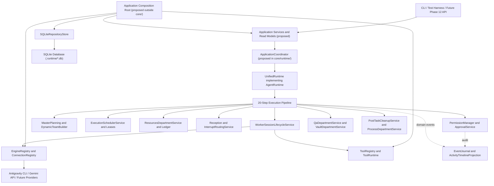
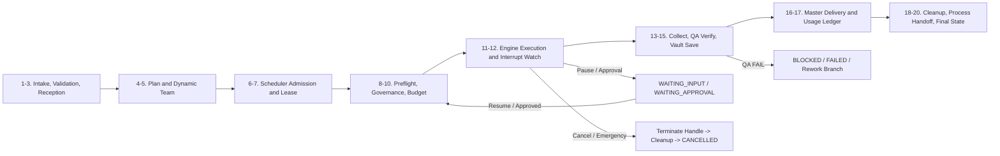
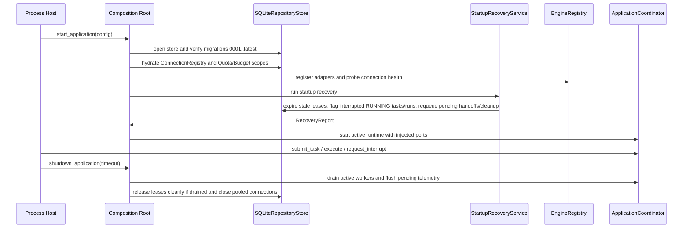
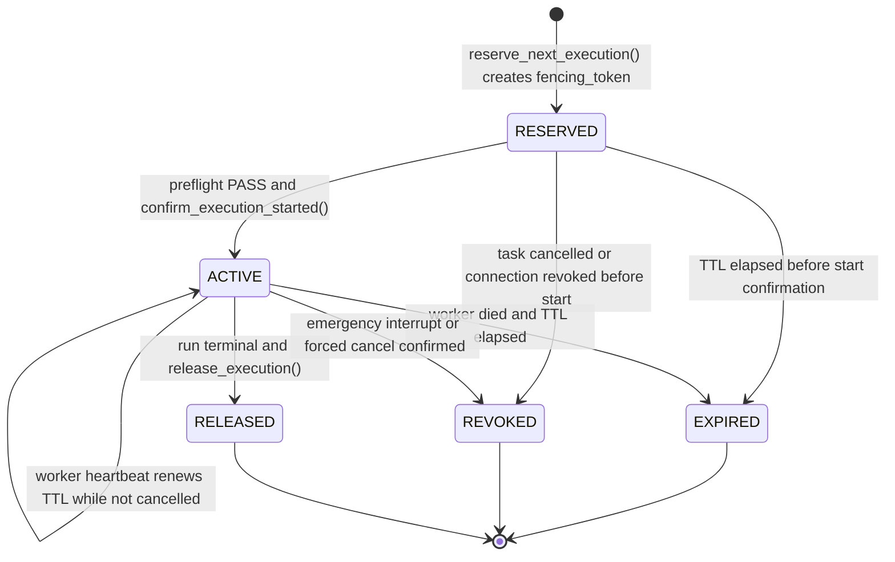
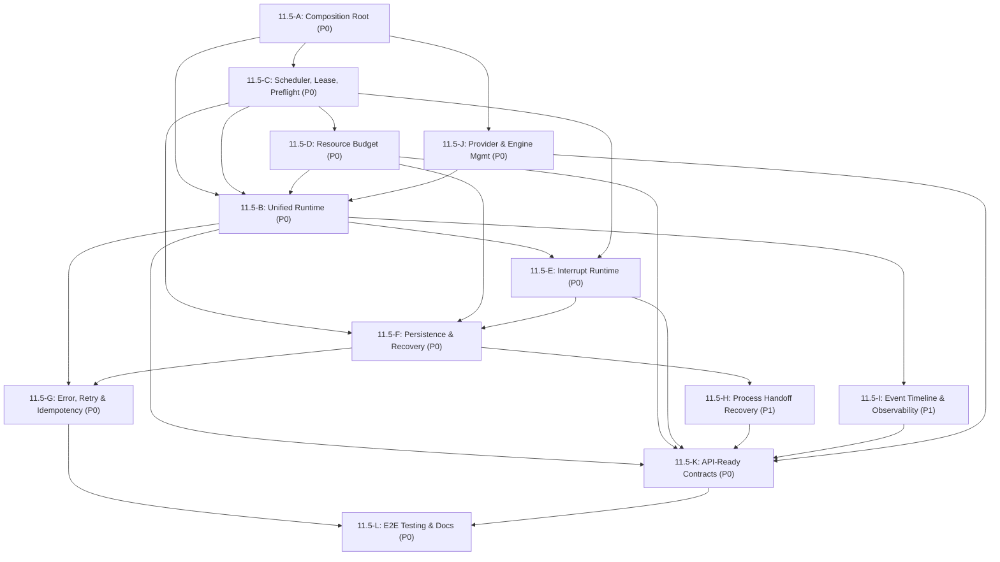

# PHASE 11.5 — APPLICATION INTEGRATION & RUNTIME READINESS

- **Document Status:** `PLANNED`
- **Target Phase ID:** `PHASE 11.5`
- **Official Name:** `PHASE 11.5 — APPLICATION INTEGRATION & RUNTIME READINESS`
- **Authoritative Upstream Baseline:** Commit `34cdc11e607baec831c017b57c36bd64615045e5` on `main`
- **Primary Roadmap Reference:** [PROGRESS.md](PROGRESS.md)
- **Architectural Source of Truth:** [SYSTEM_BLUEPRINT.md](architecture/SYSTEM_BLUEPRINT.md)

> Tài liệu này là đặc tả kỹ thuật chính thức cho **PHASE 11.5**. Mọi hạng mục triển khai trong pha này đang ở trạng thái `PLANNED`; tài liệu không khẳng định lớp tích hợp hay runtime hợp nhất đã được lập trình sẵn.

---

## SECTION 1 — PHASE OVERVIEW

- **Phase ID:** `PHASE 11.5`
- **Phase Name:** `APPLICATION INTEGRATION & RUNTIME READINESS`
- **Purpose:** Xây dựng lớp Application Composition Root, Application Coordinator, Unified Runtime, vòng đời phục hồi và hợp đồng Read Model chuẩn xác để ghép nối các service độc lập từ `PHASE 01` đến `PHASE 11` thành một hệ thống backend vận hành đồng nhất trước khi bước vào tầng HTTP/SSE và giao diện.
- **Current Project Context:** Tính đến `Gate G` tại [PHASE_11_GATE_G_AUDIT.md](reviews/PHASE_11_GATE_G_AUDIT.md), AI Village đã hoàn tất offline các module domain, state machine, governance, 17 công cụ chuẩn hóa, kho SQLite `20` migration / `69` bảng và 9 dịch vụ phòng ban (`341 passed, 25 skipped`). Dù từng phân hệ vượt qua unit test và test tích hợp dựng harness cục bộ, điểm vào runtime chính của ứng dụng tại [custom_runtime.py](../core/runtime/custom_runtime.py) vẫn chạy qua spike `P03.01` trên bộ nhớ RAM, tách biệt hoàn toàn khỏi luồng orchestration và persistence của `PHASE 04`–`11`.
- **Problem Statement:** Không có một Composition Root và Application Coordinator thống nhất. Hiện tượng hiện tại gồm `6` service trung tâm chỉ được gọi trong test, hai bộ đếm quota song song giữa Scheduler và Resources chưa đối soát, `ConnectionRegistry` lưu trên RAM không nối bảng `connections`, `WorkerSessionLifecycleService` chưa kiểm tra lease và ngân sách trước khi chạy Engine, `ProcessDepartmentService` chưa đọc `process_learning_handoffs`, và `ActivityTimelineProjection` mới định dạng `4` trên `106` loại `EventType`. Mở ngay `PHASE 12` trên nền rời rạc này sẽ kéo logic ghép nối và nghiệp vụ vào thẳng HTTP controller ở `api/`, vi phạm bất biến kiến trúc tại [boundaries.md](architecture/boundaries.md).
- **Scope:**
  1. Thiết lập Application Composition Root tuân thủ nghiêm ranh giới AST giữa `core/` và `storage/`/`engines/`/`tools/`.
  2. Thay thế đường thực thi spike trong `CustomAgentRuntime` bằng Unified Runtime có điều phối thực, quản lý vòng đời `Task` / `Run` / `Worker` và hỗ trợ hủy thật theo đúng năng lực adapter.
  3. Chuẩn hóa đường ống 20 bước từ `Request Intake` đến `Final Task State` với ranh giới transaction, governance, lease, budget, interrupt, QA và vault thống nhất.
  4. Khép kín phục hồi sau khởi động lại đối với `Task`, `Run`, expired lease, stale worker, `process_learning_handoffs`, `ExecutionRecord` và `ConnectionRegistry`.
  5. Hoàn thiện Event Timeline Projection cho execution pipeline và chuẩn hóa Application Facade / Read Models sẵn sàng cho `PHASE 12`.
- **Out of Scope:**
  1. Không triển khai đầy đủ FastAPI endpoints, SSE/WebSocket server hoặc browser authentication của `PHASE 12`.
  2. Không xây dựng Mission Control 2D của `PHASE 13` hoặc 3D scene của `PHASE 14`.
  3. Không phát triển hàng loạt adapter mới như OpenAI, Anthropic hay Ollama nếu không phục vụ trực tiếp bài kiểm tra interface mở rộng tối thiểu.
  4. Không tạo thêm phòng ban mới hay thay đổi 9 manifest phòng ban hiện hành.
  5. Không viết lại toàn bộ `ProcessDepartmentService`, `ExecutionSchedulerService`, `WorkerSessionLifecycleService` hoặc State Machine đã nghiệm thu ở `PHASE 04`–`11`.
- **Dependencies:**
  - Tiền điều kiện bắt buộc: `PHASE 01`–`11` và các cổng `Gate A`–`Gate G` đã hoàn tất ở mức baseline lưu trong [PROGRESS.md](PROGRESS.md).
  - Phụ thuộc xuôi: `PHASE 12` chỉ được khởi động khi các P0 Gate của `PHASE 11.5` đạt điều kiện thoát tại Section 22.
- **Expected Outcomes:** Có thể khởi tạo toàn bộ backend qua một Composition Root duy nhất dùng một `SQLiteRepositoryStore` mỗi vòng đời ứng dụng; chạy trơn một nhiệm vụ đa worker qua runtime thật có kiểm soát lease, budget, interrupt, QA độc lập, vault, cleanup, process handoff và khôi phục sạch sau restart.
- **Relationship with Phase 01–11:** `PHASE 11.5` không thay thế, không viết lại và không đổi trạng thái nghiệm thu lịch sử của `PHASE 01`–`11`. Pha này chỉ đóng vai trò cầu nối tích hợp các năng lực đã có thành runtime hoàn chỉnh.
- **Relationship with Phase 12:** `PHASE 11.5` cung cấp sẵn Application Commands, Read Models, Event Timeline Projection đầy đủ và Application Lifecycle để `api/` ở `PHASE 12` chỉ làm mỏng nhiệm vụ định tuyến HTTP/SSE và kiểm tra Auth/DTO, không tự lắp ráp 20 repository hay giữ logic orchestration trong controller.
- **Relationship with Phase 13:** `PHASE 13` giao diện 2D Mission Control tiêu thụ DTO của `PHASE 12` dựa trên nguồn sự thật duy nhất đã hợp nhất ở `PHASE 11.5`, bảo đảm trạng thái trên Dashboard, Inbox, Resource Monitor và Artifact Vault phản ánh trung thực execution runtime.

---

## SECTION 2 — CURRENT ARCHITECTURE AUDIT

Bảng dưới đây ghi nhận hiện trạng mã nguồn tại commit `34cdc11e607baec831c017b57c36bd64615045e5` theo đúng 6 nhãn phân loại chuẩn: `IMPLEMENTED_AND_INTEGRATED`, `IMPLEMENTED_BUT_NOT_INTEGRATED`, `PARTIALLY_IMPLEMENTED`, `MISSING`, `REQUIRES_VERIFICATION`, `PLANNED_FOR_LATER_PHASE`.

### 2.1. Module Integration Classification Matrix

| Component | Current Implementation | Integration Status | Gap | Required Action |
|---|---|---|---|---|
| **Runtime** | `CustomAgentRuntime` và `AgentWorkflowRunner` tại [custom_runtime.py](../core/runtime/custom_runtime.py) và [application.py](../core/runtime/application.py) | `PARTIALLY_IMPLEMENTED` | `CustomAgentRuntime.execute` gọi `run_master_worker_spike` trên RAM; `supports_workflow_cancellation=False`; telemetry luôn trả `estimated_cost_usd=None` và `actual_cost_usd=None`. | Xây `UnifiedRuntime` nối pipeline thật qua `ApplicationCoordinator`, giữ tương thích ngược tạm thời cho `CustomAgentRuntime`. |
| **Composition Root** | Chưa có ở mã nguồn sản xuất; các test tự lắp qua `make_department_harness` trong [conftest.py](../tests/departments/conftest.py) | `MISSING` | Không có factory hay container khởi tạo `SQLiteRepositoryStore`, registries, engine adapters và services cho ứng dụng thật. | Tạo outer Composition Root tách biệt ranh giới AST theo [test_stage_a_baseline.py](../tests/stage_a/test_stage_a_baseline.py) để cấp một `SQLiteRepositoryStore` và đồ thị phụ thuộc tường minh. |
| **Dependency Injection** | Các class nhận dependency qua constructor (`__init__`) với typing `Protocol` | `PARTIALLY_IMPLEMENTED` | Hợp đồng DI từng class đã sạch nhưng thiếu đồ thị lắp ghép tập trung, cấu hình runtime và factory cho test/prod. | Chuẩn hóa `ApplicationDependencies` và constructor injection từ Composition Root xuống `ApplicationCoordinator` và services. |
| **Master Planning** | `MasterPlanningService` trong [planning.py](../core/orchestration/planning.py) + [planning_repo.py](../storage/repositories/planning_repo.py) | `IMPLEMENTED_BUT_NOT_INTEGRATED` | Không được gọi từ `core/runtime/` hay bất kỳ controller sản xuất nào; chỉ chạy trong unit/orchestration tests. | Kết nối `create_plan` / `create_plan_with_engine` và `apply_plan_to_task` vào Bước 4 của Execution Pipeline. |
| **Dynamic Team Builder** | `DynamicTeamBuilderService` trong [team_builder.py](../core/orchestration/team_builder.py) + [team_repo.py](../storage/repositories/team_repo.py) | `IMPLEMENTED_BUT_NOT_INTEGRATED` | Chưa có lời gọi từ runtime chính; staleness check chưa tự chạy trước khi dispatch bước mới. | Nối `build_team_proposal`, `apply_team_assignment` và `check_proposal_staleness` vào Execution Pipeline. |
| **Scheduler** | `ExecutionSchedulerService` trong [scheduler.py](../core/optimization/scheduler.py) + [scheduler_repo.py](../storage/repositories/scheduler_repo.py) | `IMPLEMENTED_BUT_NOT_INTEGRATED` | Tách rời khỏi runtime chính; chưa tham gia vòng cấp phát run cho worker execution; quota bucket tách biệt khỏi Resources. | Nối `enqueue_task`, `reserve_next_execution`, `confirm_execution_started`, `release_execution` vào Coordinator. |
| **Lease** | `ExecutionLease` trong [scheduler_models.py](../core/optimization/scheduler_models.py) và `scheduler_execution_leases` ở migration `0018` | `PARTIALLY_IMPLEMENTED` | Chưa có worker heartbeat renewal định kỳ, chưa có fencing token kiểm soát ghi muộn và chưa gắn kiểm tra lease trong `WorkerSessionLifecycleService`. | Thêm fencing/ownership token trên `ExecutionLease`, heartbeat/renewal và cưỡng chế kiểm tra lease trước khi worker thực thi hoặc ghi kết quả. |
| **Worker Preflight** | `WorkerSessionLifecycleService.run_execution_preflight` 18 checks tại [worker_sessions.py](../core/orchestration/worker_sessions.py#L378-L936) | `IMPLEMENTED_BUT_NOT_INTEGRATED` | Preflight chưa kiểm tra Scheduler Lease hợp lệ và Resource Budget policy trước khi khởi chạy adapter. | Bổ sung check Scheduler Lease ownership/expiry và Resource Budget eligibility vào preflight cùng luồng chạy `execute_worker_step`. |
| **Resources** | `ResourcesDepartmentService` tại [resources.py](../core/departments/resources.py) | `PARTIALLY_IMPLEMENTED` | Lưu `_scopes` và `_inventories` trong RAM bên cạnh nhánh ledger SQLite; chưa được nối vào vòng chạy chính trước và sau step. | Chuyển state quan trọng sang bền vững qua SQLite, loại bỏ lệ thuộc RAM thuần và nối kiểm tra ngân sách vào pipeline. |
| **Resource Ledger** | Module ledger tại [resources_ledger.py](../core/departments/resources_ledger.py) + [resources_repo.py](../storage/repositories/resources_repo.py) | `IMPLEMENTED_BUT_NOT_INTEGRATED` | Chỉ được gọi qua test và [cleanup_repo.py](../storage/repositories/cleanup_repo.py); chưa ghi telemetry thực tế từ Engine/Tool executions trong runtime chính. | Tích hợp `record_usage` idempotent sau mỗi Engine/Tool execution và kiểm tra budget policy trước khi cấp phát step mới. |
| **Interrupt Routing** | `InterruptRoutingService` tại [interrupts.py](../core/departments/interrupts.py) + `ReceptionDepartmentService` tại [reception.py](../core/departments/reception.py) | `PARTIALLY_IMPLEMENTED` | `InterruptRoutingService` ghi `interrupt_incidents` nhưng chưa gọi `WorkflowLifecycleController`, `WorkerSessionLifecycleService` hay signal hủy tiến trình thật; `ReceptionDepartmentService` có nhánh dedup RAM song song. | Nối kênh xử lý ngắt với `ApplicationCoordinator`, `WorkflowLifecycleController` và worker cancellation handles; đồng bộ trạng thái `ACCEPTED` -> `APPLYING` -> `COMPLETED`. |
| **Process Handoff** | Bảng `process_learning_handoffs` và `SQLiteCleanupRepository` trong [cleanup_repo.py](../storage/repositories/cleanup_repo.py#L562-L646) + `ProcessDepartmentService` trong [process.py](../core/departments/process.py) | `PARTIALLY_IMPLEMENTED` | `PostTaskCleanupService` ghi được handoff sang `process_learning_handoffs`, nhưng `ProcessDepartmentService` chưa đọc bảng này; thiếu cơ chế retry/reconcile cho bản ghi `PENDING_PROCESS_LINK`. | Bổ sung hàng đợi/reconciler trong Process để xử lý bản ghi handoff pending, retry idempotent và khôi phục sau restart. |
| **Cleanup** | `PostTaskCleanupService` tại [cleanup.py](../core/optimization/cleanup.py) + `ManagedTempCleanupExecutor` tại [cleanup_repo.py](../storage/repositories/cleanup_repo.py#L90-L265) | `IMPLEMENTED_BUT_NOT_INTEGRATED` | Chưa tự chạy cuối Task/Run hoặc khi dọn dẹp hậu restart cho cleanup bị ngắt giữa chừng. | Gắn bước cleanup tự động sau terminal state và thêm startup reconciliation cho bản ghi dọn dẹp chưa hoàn tất. |
| **QA** | `QaDepartmentService` tại [qa.py](../core/departments/qa.py) + `verify_engine_artifact` tại [verification.py](../engines/verification.py) | `IMPLEMENTED_BUT_NOT_INTEGRATED` | `QaDepartmentService` chỉ chạy khi test gọi; `CustomAgentRuntime` hiện chỉ chạy kiểm tra file spike mức cơ bản thay cho luồng `QaDepartmentService` + `EvidenceVault`. | Bắt buộc mọi deliverable qua `QaDepartmentService.verify_deliverables` tạo `EvidenceRecord` trước khi `COMPLETED`. |
| **Vault** | `ArtifactVaultService` tại [vault.py](../storage/artifacts/vault.py), `EvidenceAndKnowledgeService` tại [vault.py](../storage/knowledge/vault.py), `VaultDepartmentService` tại [vault.py](../core/departments/vault.py) | `PARTIALLY_IMPLEMENTED` | Đã nối chéo Task snapshot và [artifacts.py](../api/artifacts.py) read endpoints, nhưng chưa được gọi tự động bởi đường chạy chính của Unified Runtime. | Nối Artifact/Evidence persistence và cross-task reference protection trực tiếp vào Execution Pipeline. |
| **Event Projection** | `ActivityTimelineProjection` tại [projections.py](../core/events/projections.py) + `replay_task_history` tại [replay.py](../core/events/replay.py) | `PARTIALLY_IMPLEMENTED` | `_format_summary` tại [projections.py](../core/events/projections.py#L64-L82) mới xử lý riêng chuyển trạng thái, tool/engine và `qa.verification_recorded`; `102/106` `EventType` rơi về chuỗi thô `{event_type} source={source}`. | Mở rộng `ActivityTimelineProjection` cho toàn bộ execution pipeline events kèm payload allowlisted đã scrub secret và metrics/trace_id. |
| **Connection Registry** | `ConnectionRegistry` trên RAM tại [connections.py](../engines/connections.py#L247-L316) + bảng `connections` trong [sqlite_store.py](../storage/repositories/sqlite_store.py#L1169-L1264) | `PARTIALLY_IMPLEMENTED` | Không có non-test caller nào gọi `save_connection` hoặc đồng bộ `SQLiteMetadataRepository` vào `ConnectionRegistry` lúc startup. | Đồng bộ hai chiều `ConnectionRegistry` và bảng `connections` có lọc secret, bảo đảm metadata khôi phục sau restart. |
| **Provider Registry** | `EngineRegistry` tại [registry.py](../engines/registry.py) với `AntigravityEngineAdapter` tại [antigravity.py](../engines/providers/antigravity.py) và `GoogleGeminiAdapter` tại [gemini.py](../engines/providers/gemini.py) | `PARTIALLY_IMPLEMENTED` | Chưa có bootstrap đăng ký adapter mặc định cho ứng dụng; kết quả health check provider chưa gắn vào preflight runtime thực tế; `agy` chưa có trên `PATH` mặc định. | Khởi tạo và kiểm tra khả dụng `EngineRegistry` từ Composition Root, bổ sung health probe fail-closed và capability matching theo step. |
| **Persistence** | `SQLiteRepositoryStore` tại [sqlite_store.py](../storage/repositories/sqlite_store.py#L1267-L1365) cùng `20` migration / `69` bảng SQLite và trigger bất biến | `IMPLEMENTED_AND_INTEGRATED` | Layer storage đã liên kết đầy đủ giữa `tasks`, `runs`, `events` và các repo con (`0` bảng mồ côi, `0` lỗi FK), nhưng `connection_ref` và một số scope Resources chưa đi qua đây từ runtime chính. | Dùng chung một instance `SQLiteRepositoryStore` cho toàn bộ lifecycle ứng dụng và khép các state còn giữ trên RAM vào DB. |
| **Recovery** | `recover_task` và `recover_run` tại [recovery.py](../storage/repositories/recovery.py) + `WorkflowLifecycleController.reconcile_interrupted_task` tại [lifecycle.py](../core/tasks/lifecycle.py) | `PARTIALLY_IMPLEMENTED` | Mới phát hiện Task/Run `RUNNING` là `NEEDS_RECONCILIATION` theo snapshot/replay; chưa tự thu hồi expired lease, stale worker session, pending handoff, incomplete cleanup hay chạy tự động lúc startup. | Bổ sung Startup Recovery Orchestrator xử lý đầy đủ expired lease, stale worker, interrupted intake/interrupt, pending handoff và cleanup dở dang. |
| **Governance** | `PermissionManager` tại [manager.py](../core/governance/manager.py) và `build_default_policy_rules` | `IMPLEMENTED_BUT_NOT_INTEGRATED` | Toàn bộ `96` lệnh kiểm tra quyền ở code đã khớp `PERMISSION_MATRIX_ACTIONS`, nhưng đường chạy `CustomAgentRuntime.execute()` hiện tại bỏ qua hầu hết chuỗi service này. | Đặt `PermissionManager` làm chốt chặn bắt buộc tại mọi điểm chuyển pha của Execution Pipeline, cấm retry hay reassign né quyền. |
| **Approval** | `ApprovalService` tại [approvals.py](../core/governance/approvals.py) + [approval_repo.py](../storage/repositories/approval_repo.py) | `IMPLEMENTED_BUT_NOT_INTEGRATED` | Single-use approval tiêu thụ nguyên tử đã chạy ở domain và preflight `WorkerSessionLifecycleService`, nhưng chưa nối với runtime wait/resume loop thực tế. | Nối `WAITING_APPROVAL` suspend và `approve` -> `resume` thông qua `ApplicationCoordinator` và `WorkflowLifecycleController`. |
| **Permission** | `PolicyEvaluator` tại [evaluator.py](../core/governance/evaluator.py) + workspace guard tại [workspace.py](../core/governance/workspace.py) | `IMPLEMENTED_AND_INTEGRATED` | Lớp evaluator và workspace boundary hoạt động nhất quán trên tất cả service phòng ban và tools; thiếu kiểm chứng toàn trình qua một Unified Runtime duy nhất. | Giữ nguyên rule precedence, kiểm chứng bổ sung ở E2E pipeline runtime thật gồm trường hợp deny và path traversal. |
| **Testing** | Bộ kiểm thử `pytest` đạt `341 passed, 25 skipped` | `PARTIALLY_IMPLEMENTED` | `22` ca live CLI/Provider bị skip khi tắt `AI_VILLAGE_RUN_LIVE=1`; `2` ca CrewAI nằm ở venv riêng; `1` ca Docker sandbox skip do Docker Desktop daemon tắt; chưa có E2E runtime hợp nhất không dùng test harness tự lắp. | Bổ sung unit, integration và ít nhất `15` kịch bản E2E chạy trực tiếp qua Composition Root và Unified Runtime; giữ tách bạch mock test với live verification. |

### 2.2. Verification of Previously Identified Issues

Đối chiếu trực tiếp `14` điểm nghi vấn kiến trúc tại thời điểm hiện tại cho kết quả như sau:

1. **`CustomAgentRuntime.execute()` với `run_master_worker_spike`:** Vẫn còn tồn tại. Tại [custom_runtime.py](../core/runtime/custom_runtime.py#L184-L205), hàm `execute` gọi trực tiếp `run_master_worker_spike(...)`.
2. **`supports_workflow_cancellation`:** Khai báo cứng `supports_workflow_cancellation=False` tại [custom_runtime.py](../core/runtime/custom_runtime.py#L149-L162), trong khi `WorkflowLifecycleController.request_cancel` và `AntigravityProcessManager` đã có sẵn hợp đồng hủy ở mức tầng dưới nhưng chưa được nối vào `AgentRuntime`.
3. **Wiring `MasterPlanningService`, `DynamicTeamBuilderService`, `WorkerSessionLifecycleService`, `ExecutionSchedulerService`, `InterruptRoutingService`, `PostTaskCleanupService`:** Chưa tích hợp. Cả `6` service không có lệnh gọi nào ngoài module định nghĩa của chúng và thư mục `tests/`.
4. **Scheduler Lease và Resource Budget trong `run_execution_preflight()`:** Chưa kiểm tra. Kiểm tra tại [worker_sessions.py](../core/orchestration/worker_sessions.py#L378-L936) xác nhận `run_execution_preflight` chưa đọc `scheduler_execution_leases` hay `resource_budget_policies`.
5. **`ConnectionRegistry` persistence và startup restoration:** Chưa có. [connections.py](../engines/connections.py#L247-L316) chỉ dùng `dict` trên RAM và hàm `save_connection` ở [sqlite_store.py](../storage/repositories/sqlite_store.py#L1169-L1264) không có caller sản xuất nào.
6. **Trạng thái chỉ nằm trên RAM trong `ResourcesDepartmentService`:** Vẫn còn tồn tại. Hai thuộc tính `self._scopes` và `self._inventories` trong [resources.py](../core/departments/resources.py#L252-L330) lưu trên RAM, tách rời khỏi [resources_repo.py](../storage/repositories/resources_repo.py).
7. **Inject và dùng Resource Ledger trong runtime thực tế:** Chưa có. `SQLiteResourcesRepository` chưa được inject vào bất kỳ runtime coordinator sản xuất nào.
8. **Phối hợp Scheduler quota và Resource Ledger:** Đang tách rời thành hai bộ đếm độc lập giữa bảng `scheduler_quota_buckets` ở migration `0018` và bảng `resource_ledger_entries` ở migration `0019`, không đồng bộ ngưỡng và mức tiêu hao với nhau.
9. **Interrupt tác động tới Run đang chạy:** Mới dừng ở ghi nhận bản ghi và phân loại định tuyến. Tại [interrupts.py](../core/departments/interrupts.py), `InterruptRoutingService` không giữ tham chiếu tới `WorkerSessionLifecycleService`, `WorkflowLifecycleController` hay tiến trình chạy thực tế.
10. **`process_learning_handoffs` retry, reconciliation và restart recovery:** Chưa có. Bảng `process_learning_handoffs` chỉ được đọc/ghi bởi [cleanup_repo.py](../storage/repositories/cleanup_repo.py); cả [process.py](../core/departments/process.py) và [recovery.py](../storage/repositories/recovery.py) đều chưa tham chiếu tới nó.
11. **Event projection hỗ trợ execution pipeline:** Chưa đủ. Tại [projections.py](../core/events/projections.py#L64-L82), `102/106` `EventType` rơi về định dạng thô `{event_type} source={source}` và thiếu thông tin định danh pipeline trong tóm tắt.
12. **Khởi tạo Provider / Engine Registry trong runtime thực tế:** Mới được dùng trong `custom_runtime.py` cho đường chạy spike và trong `MasterPlanningService` nếu được truyền vào; chưa có bootstrap thống nhất ở runtime toàn hệ thống.
13. **Governance, Approval, Permission trên execution path:** Đã cài đặt đúng ở từng service phòng ban và preflight của `WorkerSessionLifecycleService`, nhưng vì runtime chính vẫn chạy spike nên execution path mặc định của `CustomAgentRuntime` chưa đi qua đầy đủ chuỗi này.
14. **Trạng thái API và UI:** `api/` mới có đúng [artifacts.py](../api/artifacts.py) phục vụ hai GET endpoints đọc-chỉ cho `Gate E`; `ui/` giữ scaffold tĩnh từ Chặng A tại [App.jsx](../ui/src/App.jsx) hiển thị thông báo `"Runtime chưa được kết nối."`.

---

## SECTION 3 — TARGET ARCHITECTURE

Kiến trúc đích phân tách rạch ròi trách nhiệm theo đúng ranh giới AST được kiểm tra tự động trong [test_stage_a_baseline.py](../tests/stage_a/test_stage_a_baseline.py): các module trong `core/` giữ 100% thuần Python/Pydantic giao tiếp qua `Protocol` ports, tuyệt đối không import trực tiếp `sqlite3`, `storage.*`, `engines.providers.*` hay thư viện UI/HTTP; lớp lắp ghép ngoài sẽ bơm các triển khai cụ thể từ `storage/`, `engines/`, `tools/` vào `core/runtime/`.

### 3.1. Nine Architectural Layers

1. **Application Composition Root:** vị trí đề xuất `api/bootstrap.py` hoặc module bootstrap cấp ứng dụng ngoài `core/` (proposed location; cần cập nhật allowlist có kiểm soát ở [test_stage_a_baseline.py](../tests/stage_a/test_stage_a_baseline.py) nếu đặt trong `api/` hoặc thêm package bootstrap được phê duyệt). Khởi tạo cấu hình từ env/config object, mở một `SQLiteRepositoryStore` duy nhất cho một vòng đời ứng dụng, chạy kiểm tra schema migration, khởi tạo `ConnectionRegistry`, `EngineRegistry`, `ToolRegistry`, `CredentialResolver`, `ApprovalService`, `PermissionManager`, toàn bộ 9 service phòng ban, `WorkflowLifecycleController`, `ApplicationCoordinator`, `UnifiedAgentRuntime` và chạy Startup Recovery trước khi mở nhận việc.
2. **Application Services:** `core/runtime/application_services.py` (proposed location). Lớp facade mỏng cung cấp command/query và read-model DTO sẵn sàng cho `PHASE 12` bao gồm tiếp nhận Task, kích hoạt chạy, gửi interrupt, duyệt approval và đọc trạng thái tổng hợp.
3. **Application Coordinator:** `core/runtime/coordinator.py` (proposed location). Điều phối xuyên suốt vòng đời `Task` và `Run`, giữ tuần tự thực thi 20 bước qua các Port trừu tượng, quản lý concurrency background runs, trace ID, retry và nối interrupt trực tiếp vào run đang mở.
4. **Unified Runtime:** triển khai qua `UnifiedAgentRuntime` trong `core/runtime/unified_runtime.py` (proposed location) và chuyển tiếp có kiểm soát từ [custom_runtime.py](../core/runtime/custom_runtime.py). Hiện thực `AgentRuntime`, kết nối `ApplicationCoordinator` với `MasterPlanningService`, `DynamicTeamBuilderService`, `ExecutionSchedulerService`, `WorkerSessionLifecycleService`, quản lý cancel handle và telemetry tổng hợp trung thực.
5. **Execution Pipeline:** chuẩn hóa trong `core/runtime/pipeline.py` (proposed location). Thực thi xác định 20 bước từ intake tới delivery, cleanup và process handoff theo state machine tại [transitions.py](../core/tasks/transitions.py).
6. **Domain Services:** giữ nguyên vị trí các module hiện có tại `core/orchestration/`, `core/optimization/`, `core/departments/`, `core/governance/`, `core/agents/`, `core/tools/`, `core/tasks/`, nhận nâng cấp tối thiểu theo phạm vi tích hợp.
7. **Repository Layer:** `storage/repositories/`, `storage/artifacts/`, `storage/knowledge/`, `storage/db/`. Quản lý SQLite WAL, transaction `BEGIN IMMEDIATE`, trigger bất biến, recovery và repository cho connection metadata lẫn resources scopes.
8. **Engine / Provider Layer:** `engines/`. `EngineRegistry`, `ConnectionRegistry` đồng bộ SQLite, `EnvCredentialResolver`, `AntigravityEngineAdapter`, `GoogleGeminiAdapter`, health check và failure mapping thống nhất.
9. **Event / Observability Layer:** `core/events/`. `EventJournal`, `replay_task_history`, `ActivityTimelineProjection`, trace/correlation propagation và bộ lọc redact secret cho toàn bộ payload ra log/timeline.

### 3.2. Layer Interaction Diagram

### 3.3. Execution Pipeline Flow Diagram

### 3.4. Application Lifecycle Diagram (Startup to Shutdown)

---

## SECTION 4 — APPLICATION COMPOSITION ROOT

Application Composition Root là điểm lắp ghép duy nhất cho toàn bộ ứng dụng backend, bảo đảm không có service nào tự mở kết nối database ngầm hay dùng biến toàn cục ẩn.

### 4.1. Responsibilities & Lifecycle

1. **Configuration Loading:** Đọc cấu hình tường minh qua Pydantic model `ApplicationConfig` nhận từ môi trường hoặc test override: `db_path`, `workspace_root`, `vault_root`, `managed_temp_root`, `default_provider_id`, `credential_ref_map`, `scheduler_poll_interval_ms`, `lease_ttl_seconds`, `heartbeat_interval_seconds`, `shutdown_grace_seconds` và `environment_mode` phân tách `production` với `test`.
2. **Repository & Database Lifecycle:** Kiểm tra schema version tối thiểu bằng `apply_migrations` khi cho phép auto-migrate ở test/local setup hoặc `verify_schema_compatibility` fail-closed ở runtime nghiêm ngặt; mở đúng `1` instance [`SQLiteRepositoryStore`](file:///C:/DoCho/AI-Village/storage/repositories/sqlite_store.py#L1267) trên mỗi vòng đời ứng dụng và đóng sạch via `store.close()` khi shutdown.
3. **Dependency Injection Graph:** Khởi tạo tường minh không ẩn state theo thứ tự phụ thuộc:
   - `SQLiteRepositoryStore` cấp `.events`, `.tasks`, `.runs`, `.sessions`, `.metadata`, `.approvals`, `.agents`, `.plans`, `.teams`, `.worker_sessions`, `.handoffs`, `.collaboration`, `.tools`, `.process`, `.skills`, `.reception`, `.interrupts`, `.scheduler`, `.resources`, `.cleanup`, `.lifecycle`.
   - Governance: `ApprovalService` -> `PolicyEvaluator` -> `PermissionManager`.
   - Vault & Tools: `ArtifactVaultService`, `EvidenceAndKnowledgeService`, `ToolRegistry` + `register_phase07_tools`, `ToolRuntime`.
   - Engines: `EnvCredentialResolver`, `ConnectionRegistry` nạp từ `SQLiteMetadataRepository.list_connections`, `EngineRegistry` đăng ký adapter chuẩn hoặc fake adapter khi test.
   - Orchestration & Optimization: `AgentRegistryService`, `AgentRecruitmentService`, `MasterPlanningService`, `DynamicTeamBuilderService`, `WorkerHandoffService`, `MeetingCoordinatorService`, `CollaborationDeliveryService`, `WorkflowLifecycleController` gắn `SQLiteLifecyclePersistenceAdapter`, `ExecutionSchedulerService`, `PostTaskCleanupService`, `WorkerSessionLifecycleService`.
   - Departments: 9 services phòng ban dùng chung các port tương ứng.
   - Top-level: `ApplicationCoordinator`, `UnifiedAgentRuntime`, `ApplicationReadService`.
4. **Startup Recovery Execution:** Chạy đồng bộ một lượt phục hồi trước khi chuyển `ApplicationRuntime` sang trạng thái `READY` để nhận task mới.
5. **Background Loop & Shutdown Handling:** Nếu bật background scheduler/lease watchdog, mọi vòng nền phải giữ `threading.Event` / `asyncio.Task` có tên rõ ràng, hỗ trợ `shutdown(grace_seconds)` dừng nhận mới, chờ worker đang đóng transaction kết thúc, flush cleanup/ledger và gọi `store.close()`.

### 4.2. Architectural Constraints on Composition Root

- **Strict AST Boundary:** Do [test_stage_a_baseline.py](../tests/stage_a/test_stage_a_baseline.py) và các AST test cấm `core/` import `storage/` hay `sqlite3`, Composition Root phải nằm ngoài `core/`, còn `core/runtime/` chỉ định nghĩa các `Protocol` port và `ApplicationContainerProtocol`.
- **Single Store Lifetime:** Mọi repository trong một phiên chạy ứng dụng phải dùng chung thread-local pool từ cùng `SQLiteRepositoryStore` để transaction `BEGIN IMMEDIATE` không xung đột khóa DB.
- **No Uncontrolled Singletons:** Cấm dùng module-level global store hay lazy singleton ngầm; mỗi test có thể tạo `build_application_container(config, overrides=...)` độc lập hoàn toàn với `tmp_path` và fake adapter/sandbox.

### 4.3. Acceptance Criteria & Test Cases

- **AC-4.1:** Khởi tạo thành công hai container song song trỏ tới hai file SQLite độc lập trong cùng process Python mà không chia sẻ state qua biến toàn cục.
- **AC-4.2:** Tiêm `FakeEngineAdapter` qua `EngineRegistry` override thay vì Antigravity thật mà không cần sửa bất kỳ dòng code nào trong `core/`.
- **AC-4.3:** Gọi `shutdown()` đóng toàn bộ pooled SQLite connection trong `SQLiteRepositoryStore` và giải phóng khóa file DB trên Windows.
- **Test Cases:**
  1. `test_composition_root_builds_isolated_containers_and_closes_cleanly`
  2. `test_composition_root_rejects_unmigrated_database_when_strict`
  3. `test_composition_root_hydrates_connections_and_runs_startup_recovery`
  4. `test_composition_root_accepts_mock_engine_and_tool_sandbox_overrides`

---

## SECTION 5 — UNIFIED RUNTIME

Unified Runtime thay thế luồng thử nghiệm `run_master_worker_spike` trong [custom_runtime.py](../core/runtime/custom_runtime.py) bằng bộ điều phối chính thức đi qua toàn bộ máy trạng thái, orchestration và phòng ban.

### 5.1. Interface & Replacement Strategy

- **Contract Compatibility:** Giữ nguyên giao diện [`AgentRuntime`](../core/runtime/contract.py) với ba phương thức `get_runtime_info()`, `execute(request, event_callback=...)` và phương thức hủy có cấu trúc bổ sung khi mở rộng sang runtime điều phối thật.
- **Migration Path for `CustomAgentRuntime`:** Không xóa `CustomAgentRuntime` đột ngột để tránh gãy các test `P03.03` đang kiểm thử contract cũ. Thay vào đó:
  1. Triển khai `UnifiedAgentRuntime` (`runtime_id="ai_village.unified_v1"`) ủy quyền toàn bộ vào `ApplicationCoordinator`.
  2. Cập nhật `CustomAgentRuntime` nhận optional `coordinator` từ Composition Root để điều hướng đường chạy chuẩn khi được cấp đầy đủ dependency, đồng thời giữ chế độ legacy chỉ khi caller dùng constructor rỗng cũ với cảnh báo deprecated rõ ràng trong telemetry/log cho đến khi toàn bộ caller test chuyển xong.
- **Truthful Cancellation Declaration:** Trường `supports_workflow_cancellation` trong `AgentRuntimeInfo` chỉ được phép trả về `True` sau khi đường nối `ApplicationCoordinator.request_cancel()` -> `InterruptRoutingService` -> `WorkflowLifecycleController.request_cancel()` -> `WorkerSessionLifecycleService.terminate_session()` được cài đặt và kiểm thử xác nhận chấm dứt tiến trình thật trên OS (`CANCEL_CONFIRMED`). Trước thời điểm đó phải giữ `False`.

### 5.2. Runtime Execution & Attribution Guarantees

- **Correlation & Trace Propagation:** Mỗi lần `execute` hoặc `submit_task` sinh một `trace_id` / `correlation_id` gốc gắn xuyên suốt Intake -> Plan -> Team -> Scheduler Lease -> Worker Step -> Tool Invocation -> QA -> Vault -> Ledger -> Cleanup -> Process Handoff.
- **Execution Context Isolation:** Mỗi Task chạy trong workspace `workspace/{task_id}/` tách biệt; nhiều `Run` hoặc nhiều `WorkerSession` trên cùng một Task vẫn giữ `logical_session_id` và `provider_conversation_id` độc lập theo [worker_sessions.py](../core/orchestration/worker_sessions.py).
- **Error Propagation:** Mọi exception nghiệp vụ hoặc lỗi từ Engine/Tool đều được ánh xạ thành `AgentRuntimeError` hoặc `RunErrorRef` đã lọc bí mật, đồng thời kích hoạt nhánh cập nhật State Machine thay vì làm chết tiến trình coordinator không lưu vết.
- **Telemetry Integrity:** `AgentRuntimeTelemetry` tổng hợp từ `resource_ledger_entries` thực tế của run; nếu bất kỳ bước nào không có token/cost từ Provider, giữ nguyên `None` và gắn `telemetry_status="UNAVAILABLE_FROM_PROVIDER"`.

---

## SECTION 6 — EXECUTION PIPELINE

Đường ống thực thi chuẩn gồm `20` bước kế tiếp theo hợp đồng state machine đã khóa tại [transitions.py](../core/tasks/transitions.py):
- `TaskStatus`: `QUEUED`, `ASSIGNED`, `RUNNING`, `WAITING_INPUT`, `WAITING_APPROVAL`, `BLOCKED`, `COMPLETED`, `FAILED`, `CANCELLED`.
- `RunStatus`: `PENDING`, `RUNNING`, `WAITING_INPUT`, `WAITING_APPROVAL`, `BLOCKED`, `SUCCEEDED`, `FAILED`, `CANCELLED`, `TIMED_OUT`.

Không tự ý thêm giá trị trạng thái mới trái `VALID_TASK_STATUSES` hoặc `VALID_RUN_STATUSES`. Trạng thái `partial success` hoặc `interrupted` được biểu diễn bằng kết hợp trạng thái hợp lệ hiện hành kèm cờ metadata, checklist item còn mở hoặc `RunRecoveryReport` trạng thái `NEEDS_RECONCILIATION`.

### 6.1. Twenty-Step Canonical Pipeline Specification

| Step | Input | Output | Responsible Service | State Transition | Required Validation | Possible Errors | Retry Policy | Event to Emit | Persistence Requirement |
|---|---|---|---|---|---|---|---|---|---|
| **1. Request Intake** | Prompt, actor, `conversation_id`, `idempotency_key`, target paths | `UserRequestIntakeOutcome`, `task_id` hoặc `TaskRefinement` | `ReceptionDepartmentService` | `Task -> QUEUED` nếu tạo mới | Xác thực `claimed_actor_id == auth_context.actor_id`, schema không chứa secret | `ACTOR_IDENTITY_MISMATCH`, `STALE_INTAKE_VERSION`, `CONFLICT_REJECTED` | Idempotent theo `fingerprint` + `intake_id`; retry an toàn nếu trùng fingerprint | `reception.request_received` hoặc `reception.task_refined`, `task.created` | Transaction SQLite `intake_requests`, `conversations`, `tasks`, `events` |
| **2. Request Validation** | `Task`, workspace context, attachments | Validated request context, input workspace files | `ApplicationCoordinator` + `workspace` guard | Giữ `QUEUED` | Canonical path trong `workspace/{task_id}/inputs/`, kiểm size và `TrustedAuthContext` | `WORKSPACE_VIOLATION`, `VALIDATION_ERROR`, `SECRET_REJECTED` | Không retry lỗi validation; fail ngay | `runtime.error` nếu từ chối sớm | Lưu checklist sơ bộ hoặc audit error event |
| **3. Reception Classification** | Request intent, active runs cùng conversation | Classification, priority, action inbox item nếu cần làm rõ | `ReceptionDepartmentService` | Giữ `QUEUED` hoặc `WAITING_INPUT` nếu thiếu thông tin bắt buộc | Không trộn `conversation_id` của task khác; phân tách làm rõ với yêu cầu mới | `TASK_ID_REQUIRED_FOR_REFINEMENT`, `PERMISSION_DENIED` | Idempotent | `reception.clarification_requested`, `notification.created` | `action_inbox_items`, `reception_dedup_state` |
| **4. Master Planning** | `StructuredUserBrief`, available capabilities | `MasterWorkPlan` trạng thái `APPLIED`, checklist items | `MasterPlanningService` + `PersistentWorkflowService` | `QUEUED` giữ nguyên tới khi gán team | Quyền `task.update_plan`; step `allowed_write_paths` nằm trong workspace Task | `PLAN_GOVERNANCE_DENIED`, `PLAN_APPROVAL_REQUIRED`, `STALE_PLAN_VERSION` | Retry tối đa theo transient engine error nếu plan sinh qua Engine | `plan.created`, `plan.applied`, `checklist.item_updated` | `master_plans`, `master_plan_revisions`, `checklist_items` |
| **5. Team Building** | Applied `MasterWorkPlan`, `AgentRegistryService` | `TeamProposal` trạng thái `ASSIGNED`, danh sách pinned SHA-256 | `DynamicTeamBuilderService` + `PersistentWorkflowService` | `Task: QUEUED -> ASSIGNED` | Xác nhận từng worker là `ACTIVE`, capability khớp step, manifest hash khớp version | `TEAM_GOVERNANCE_DENIED`, `TEAM_APPROVAL_REQUIRED`, `STALE_MANIFEST_REVISION` | Rebuild team proposal nếu manifest trôi trước khi run | `team.proposal_created`, `team.assigned`, `task.status_changed` | `team_proposals`, `team_proposal_revisions`, `tasks` |
| **6. Scheduler Admission** | `Task` trạng thái `ASSIGNED`, priority, target `connection_id` | `QueueEntry` (`READY` / `BLOCKED_*`), slot evaluation | `ExecutionSchedulerService` | Giữ `ASSIGNED` hoặc chuyển `Task -> BLOCKED` nếu chặn dài hạn | Kiểm tra `ConnectionQuotaPolicy`, quota bucket chung, rate limit window, cấm xoay key né hạn mức | `BLOCKED_BY_CONCURRENCY`, `BLOCKED_BY_RATE_LIMIT`, `BLOCKED_BY_QUOTA`, `KEY_ROTATION_FORBIDDEN` | Đợi xếp hàng theo backoff; cấm xoay connection trái policy | `scheduler.task_enqueued`, `scheduler.execution_blocked`, `scheduler.key_rotation_blocked` | `scheduler_queue_entries`, `scheduler_quota_buckets`, `scheduler_rate_limit_events` |
| **7. Lease Acquisition** | Eligible `QueueEntry`, `run_id`, lease TTL | `ExecutionLease` (`RESERVED` -> `ACTIVE`), `fencing_token` | `ExecutionSchedulerService` + `PersistentWorkflowService` | Tạo `Run: PENDING`, cấp lease `RESERVED` | Kiểm tra chưa có lease active trùng run, TTL dương hợp lệ | `SCHEDULER_CONFLICT`, `LEASE_ALREADY_HELD`, `STALE_QUEUE_STATE` | Retry reserve ở chu kỳ scheduler tiếp theo nếu mất lock lạc quan | `scheduler.execution_reserved`, `scheduler.execution_started` | `runs`, `scheduler_execution_leases`, `scheduler_queue_entries` |
| **8. Worker Preflight** | `WorkerExecutionRequest`, active `ExecutionLease` | `WorkerExecutionPreflightReport` (`allowed=True/False`) | `WorkerSessionLifecycleService` | Giữ `Run: PENDING` / `Task: ASSIGNED` tới khi pass | Toàn bộ checks: Task/Run, Plan APPLIED, Team ASSIGNED, SHA-256, Dep/Handoff, Engine cap, Workspace, Lease hợp lệ, Budget khả dụng | `WORKER_PREFLIGHT_BLOCKED`, `MANIFEST_HASH_DRIFT`, `LEASE_INVALID`, `BUDGET_EXCEEDED` | Không auto-retry nếu do drift/permission; yêu cầu replan/approval | Không đổi state nếu bị từ chối; log lý do chặn | `worker_session_bindings` khi khởi tạo session |
| **9. Governance / Approval / Permission** | `PolicyRequest`, optional `approval_id` | `PolicyDecision` (`ALLOW`), consumed approval nếu có | `PermissionManager` + `ApprovalService` | Nếu `APPROVAL_REQUIRED`: `Task -> WAITING_APPROVAL`, `Run -> WAITING_APPROVAL` | `request_fingerprint` khớp nguyên vẹn, `approval_id` còn hạn, chưa từng consume, không `system_deny` | `PERMISSION_DENIED`, `APPROVAL_REQUIRED`, `APPROVAL_EXPIRED`, `APPROVAL_CONSUMPTION_FAILED` | Không retry hành động bị `DENY`; chỉ resume sau khi con người duyệt | `governance.decision_recorded`, `approval.requested`, `approval.resolved` | `approval_requests`, `events`, `action_inbox_items` |
| **10. Resource Budget Validation** | `ResourceBudgetPolicy`, estimated step cost, active bucket | Pre-check allowance hoặc alert/approval escalation | `ResourcesDepartmentService` | Nếu chạm ngưỡng cứng hoặc fallback đắt: `WAITING_APPROVAL` hoặc `BLOCKED` | Tách biệt `None` với `0`; mọi vượt ngưỡng ngân sách cần `human_operator` approval | `BUDGET_EXCEEDED`, `QUOTA_CRITICAL`, `UNAUTHENTICATED_ACTOR` | Không retry vượt ngưỡng ngân sách nếu chưa có duyệt | `resources.budget_warning_triggered`, `resources.budget_critical_triggered` | `resource_threshold_alerts`, `notifications`, `action_inbox_items` |
| **11. Engine / Provider Execution** | Active `WorkerSessionBinding`, prompt, allowed tools | `EngineResult`, `ToolExecutionRecord`s, worker output files | `WorkerSessionLifecycleService` + `EngineRegistry` + `ToolRuntime` | `Task: ASSIGNED -> RUNNING`, `Run: PENDING -> RUNNING`, heartbeat lease | Kiểm tra fencing token trước/trong lúc chạy, timeout cứng, tool gọi qua `ToolRuntime` | `TIMED_OUT`, `RATE_LIMITED`, `QUOTA_EXCEEDED`, `PROVIDER_ERROR`, `TOOL_UNSUPPORTED_BY_PROVIDER` | Retry hữu hạn theo `FallbackPolicy` và `safe_retry` | `run.started`, `session.started`, `engine.event_forwarded`, `tool.call_*` | `run_executions`, `worker_session_transitions`, `tool_executions`, `events` |
| **12. Interrupt Monitoring** | Tín hiệu hủy, pause, refinement, emergency trong khi chạy | Quyết định tiếp tục, tạm dừng, chuyển hướng hoặc dừng cây tiến trình | `ApplicationCoordinator` + `InterruptRoutingService` + `WorkflowLifecycleController` | `WAITING_INPUT`, `WAITING_APPROVAL`, `BLOCKED` hoặc `CANCELLED` | Check checkpoint `check_checkpoint_can_continue`, kiểm ownership handle và xác nhận process exit | `OWNERSHIP_REJECTED`, `PROCESS_NOT_OBSERVABLE`, `CANCEL_FAILED` | Retry polling xác nhận thoát process tới timeout | `reception.interrupt_*`, `workflow.cancel_requested`, `run.cancelled` | `interrupt_incidents`, `interrupt_events`, `run_executions`, `tasks`, `runs` |
| **13. Result Collection** | Raw output, handoffs, optional multi-worker meetings | `WorkerHandoffRecord`, `MeetingRecord`, candidate deliverables | `WorkerHandoffService` + `MeetingCoordinatorService` | Giữ `Run: RUNNING` tới khi các bước bắt buộc xong | Check conflict file giữa worker qua `CollaborationDeliveryService`; họp có giới hạn lượt | `COLLABORATION_CONFLICT`, `MEETING_TURN_LIMIT_EXCEEDED`, `STALE_LEASE_WRITE_REJECTED` | Cho phép conflict resolution / rework loop có giới hạn | `agent.handoff`, `meeting.*`, `collaboration.conflict_*` | `worker_handoffs`, `meetings`, `meeting_decisions`, `worker_conflicts` |
| **14. QA Verification** | Candidate deliverables, test evidence, expected brief | `QaVerdictStatus` (`PASS`/`FAIL`), bất biến `EvidenceRecord` | `QaDepartmentService` + `EvidenceAndKnowledgeService` | Nếu QA fail không có nhánh sửa: `Run -> FAILED`, `Task -> FAILED` hoặc `BLOCKED` | Độc lập bắt buộc `verifier_actor_id != producer_agent_id`; SHA-256 khớp file thực tế | `QA_INDEPENDENCE_VIOLATION`, `QA_EVIDENCE_REQUIRED`, `VERIFIED_FAIL` | Cho phép mở lại rework branch nếu còn retry budget; cấm bỏ qua QA | `qa.verification_recorded`, `evidence.recorded`, `checklist.item_updated` | `evidence_records`, `artifact_registry_entries.verification_status` |
| **15. Vault / Artifact Persistence** | Verified deliverable bytes, metadata, tags | `ArtifactRegistryEntry`, SemVer, SHA-256, `artifact_task_references` | `VaultDepartmentService` + `ArtifactVaultService` | Cập nhật `Task.artifact_ids` trước khi đóng Run | Canonical path, zero secret trong nội dung/metadata khi cần redact, atomic sync vào Task snapshot | `VAULT_APPROVAL_REQUIRED`, `ARTIFACT_HASH_MISMATCH`, `ACCESS_DENIED` | Idempotent theo `(task_id, logical_key, sha256)` | `artifact.recorded`, `artifact.version_registered` | `vault_blobs`, `artifact_registry_entries`, `tasks` |
| **16. Delivery** | Verified artifacts, evidence IDs, handoff history | `MasterDeliverySummary` | `CollaborationDeliveryService` | Giữ `Run: RUNNING` chuẩn bị hoàn tất | Mọi deliverable đạt `VERIFIED_PASS` và có `evidence_id`; không còn conflict unresolved | `UNVERIFIED_DELIVERABLE_REJECTED`, `UNRESOLVED_CONFLICT` | Idempotent delivery record theo `(task_id, run_id)` | `master.delivery_compiled` | `master_deliveries` |
| **17. Resource Usage Recording** | `EngineTelemetry`, `HostProcessSample`, tool duration/cost | `ResourceLedgerEntry`, `TaskResourceUsageSummary`, alerts | `ResourcesDepartmentService` | Không đổi state nếu trong ngưỡng; vượt ngưỡng chỉ phát alert khi sắp đóng | Giữ `None` + `UNAVAILABLE_FROM_PROVIDER` nếu thiếu số liệu; idempotency key theo step/tool/run | `DUPLICATE_LEDGER_CONFLICT`, `BUDGET_CRITICAL` | Idempotent write an toàn khi retry ghi ledger | `resources.ledger_recorded`, `resources.budget_*` | `resource_ledger_entries`, `resource_threshold_alerts` |
| **18. Cleanup** | `PostTaskCleanupRequest`, lease cần nhả, temp paths | `PostTaskCleanupOutcome`, released leases, closed sessions | `PostTaskCleanupService` + `ManagedTempCleanupExecutor` + `ExecutionSchedulerService` | Giải phóng lease `ACTIVE -> RELEASED` và đóng `WorkerSession` | Cấm xóa ngoài `managed_temp_root`, cấm xóa file dùng chung bởi task khác qua `artifact_task_references` | `CLEANUP_BLOCKED_ACTIVE_TASK`, `BLOCKED_UNSAFE_PATH`, `BLOCKED_SHARED_REF` | Idempotent cleanup key; đánh dấu `PARTIAL` để startup recovery xử lý lại nếu hỏng | `resources.cleanup_recorded`, `resources.cleanup_blocked`, `scheduler.execution_released` | `post_task_cleanups`, `post_task_cleanup_items`, `scheduler_execution_leases` |
| **19. Process Learning Handoff** | Task evidence bundle, cleaned summary | `ProcessLearningHandoffRecord`, `TaskRetrospectiveOutcome` | `PostTaskCleanupService` + `ProcessDepartmentService` | Không mutate Task state; độc lập với terminal outcome | Không bịa lỗi/skill usage; lưu `PENDING_PROCESS_LINK` nếu chưa tổng hợp ngay | `PROCESS_HANDOFF_CONFLICT`, `HISTORY_READER_UNAVAILABLE` | Retry nền hoặc startup recovery cho bản ghi `PENDING_PROCESS_LINK` | `resources.process_handoff_recorded`, `process.retrospective_recorded` | `process_learning_handoffs`, `task_retrospectives`, `task_retrospective_runs` |
| **20. Final Task State** | Verified QA evidence, completed Run, closed cleanup | Terminal `Task` và `Run` nhất quán giữa snapshot và replay | `ApplicationCoordinator` + `PersistentWorkflowService` | `Run: RUNNING -> SUCCEEDED`, `Task: RUNNING -> COMPLETED` hoặc nhánh `FAILED`/`CANCELLED`/`BLOCKED` | `COMPLETED` bắt buộc có `evidence_id` nguồn `qa_verifier`; `CANCELLED` chỉ sau khi xác nhận dừng tiến trình | `UNVERIFIED_COMPLETION`, `CANCELLATION_NOT_CONFIRMED`, `TERMINAL_STATE_MUTATION` | Không retry sau khi đã vào terminal state; lock lạc quan chặn ghi đè | `run.completed` / `run.failed` / `run.cancelled`, `task.status_changed` | Atomic SQLite transaction `tasks`, `runs`, `events` |

### 6.2. Terminal and Non-Terminal Outcome Distinction

- **`Success (COMPLETED)`:** Tất cả bước bắt buộc hoàn thành, có `QaVerificationEvidence(verification_status="VERIFIED_PASS")` độc lập, artifact đã vào Vault và Run ở trạng thái `SUCCEEDED`.
- **`Partial Success:`** Không có trạng thái Task riêng gọi là `PARTIAL`; khi một số bước phụ thất bại hoặc bị bỏ qua nhưng nghiệp vụ cho phép tiếp tục, kết quả thể hiện qua chi tiết `checklist_items` (`COMPLETED` / `FAILED`) và `MasterDeliverySummary`, còn trạng thái Task chỉ chuyển `COMPLETED` nếu tiêu chí tối thiểu vẫn vượt qua QA độc lập, ngược lại chuyển `FAILED` hoặc `BLOCKED`.
- **`Failed (FAILED)`:** Lỗi không thể phục hồi ở Engine/Tool sau khi hết giới hạn retry, QA trả `VERIFIED_FAIL` hết lượt sửa, hoặc vi phạm điều kiện bất biến.
- **`Cancelled (CANCELLED)`:** Chỉ thiết lập sau khi `WorkflowLifecycleController` xác nhận các tiến trình thực thi con đã dừng và lease đã được thu hồi.
- **`Blocked (BLOCKED)`:** Hết quota/ngân sách, thiếu kết nối khả dụng, xung đột chưa phân xử hoặc chờ điều kiện ngoài; có thể giải tỏa để trở lại `QUEUED`, `ASSIGNED` hoặc `RUNNING` theo đúng `TASK_ALLOWED_TRANSITIONS`.
- **`Interrupted / Suspended:`** Khi đang chờ input hoặc approval, hệ thống chuyển `WAITING_INPUT` / `WAITING_APPROVAL`; nếu tiến trình bị tắt đột ngột giữa trạng thái `RUNNING`, `recover_task` giữ trạng thái `NEEDS_RECONCILIATION` thay vì tự ý suy đoán thành công hoặc thất bại.

---

## SECTION 7 — SCHEDULER, LEASE AND WORKER PREFLIGHT

Phần này hợp nhất `ExecutionSchedulerService` tại [scheduler.py](../core/optimization/scheduler.py) với `WorkerSessionLifecycleService` tại [worker_sessions.py](../core/orchestration/worker_sessions.py) để ngăn chạy lố concurrency, mất lease giữa chừng và ghi đè từ worker cũ.

### 7.1. Core Mechanics

1. **Admission Control & Fair Queueing:** `enqueue_task` tạo `QueueEntry` với `priority_rank` dựa trên `TaskPriority` cộng `wait_aging` chống đói tài nguyên ở queue thấp. Scheduler từ chối kích hoạt khi chạm `max_concurrency`, vượt `rate_limit_max_requests` trong `rate_limit_window_seconds` hoặc cạn `quota_limit_units` trên bucket tính qua `compute_quota_bucket_key`.
2. **Prohibition of Key Rotation Evasion:** Giữ nguyên cơ chế `KeyRotationForbiddenError` khi cố chuyển đổi sang kết nối khác cùng bucket để né `BLOCKED_BY_RATE_LIMIT` hoặc `BLOCKED_BY_QUOTA`.
3. **Lease Ownership & Fencing Token:** Mỗi lần `reserve_next_execution` cấp `ExecutionLease` phải đính kèm một `fencing_token` tăng đơn điệu hoặc khóa phiên bản gắn cặp `(lease_id, lease_epoch)` đối chiếu tại mọi điểm ghi kết quả `WorkerSessionLifecycleService`, `ArtifactVaultService` và `PersistentWorkflowService`. Worker nắm lease cũ đã bị `EXPIRED` hoặc `REVOKED` sẽ bị từ chối ghi dữ liệu bằng lỗi `STALE_LEASE_FENCING_REJECTED`.
4. **TTL, Heartbeat & Renewal:** Lease có `expires_at` mặc định theo cấu hình. Worker đang chạy phát heartbeat theo chu kỳ ngắn hơn `TTL / 3` để gia hạn `lease_expires_at` có điều kiện (`state == ACTIVE` và chưa có yêu cầu `CANCEL` hoặc `REVOKED`).
5. **Expiration, Revocation & Reassignment:** Khi quá `expires_at` mà worker không heartbeat, watchdog hoặc chu kỳ scheduler kế tiếp chạy `recover_expired_leases` chuyển lease sang `EXPIRED`, giải phóng slot concurrency bucket, chuyển trạng thái session bị treo sang `TERMINATED`/`EXPIRED`, và đưa task về hàng đợi hoặc cho phép Master reassign theo policy.
6. **Extended Worker Preflight:** Mở rộng `run_execution_preflight` từ 18 kiểm tra hiện nay lên kiểm tra thêm:
   - Check 19 (`scheduler_lease_valid`): Run phải có `ExecutionLease` trạng thái `RESERVED` hoặc `ACTIVE`, đúng `task_id` + `run_id`, chưa hết `expires_at` và đúng `fencing_token`.
   - Check 20 (`resource_budget_eligible`): Bước chạy không vi phạm hard-stop budget policy đang kích hoạt tại `ResourcesDepartmentService` và có `approval_id` nếu policy yêu cầu phê duyệt vượt ngưỡng.

### 7.2. Lease & Worker Ownership State Diagram

### 7.3. Mandatory Scheduler, Lease & Preflight Test Cases

1. **Lease hết hạn giữa lúc worker treo:** Worker A giữ lease `TTL = 10s`, ngưng gửi heartbeat; ở giây thứ `11`, `recover_expired_leases` chuyển lease sang `EXPIRED`, giải phóng slot concurrency và cho phép Task mới nhận slot.
2. **Worker chết đột ngột khi đang chạy:** Tiến trình worker kết thúc bất thường không gọi `release_execution`; sau khi lease hết hạn hoặc watchdog phát hiện handle thoát, coordinator chuyển Run/Session về trạng thái phục hồi an toàn thay vì kẹt vĩnh viễn ở `RUNNING`.
3. **Hai worker tranh cùng một Run:** Hai worker đồng thời gọi `confirm_execution_started` hoặc `execute_worker_step` trên cùng `run_id`; chỉ worker giữ đúng `lease_id` + `fencing_token` hợp lệ được phép thực thi, worker còn lại bị chặn ngay tại transaction lock.
4. **Worker cũ ghi dữ liệu sau khi lease mất hiệu lực:** Worker A chậm mạng tỉnh lại sau khi lease của nó đã `EXPIRED` và Worker B đã giữ lease mới; mọi thao tác cập nhật Run state hoặc ghi artifact từ Worker A dùng `fencing_token` cũ phải bị từ chối fail-closed.
5. **Preflight bị từ chối vì thiếu lease hoặc lệch SHA-256:** Chạy `execute_worker_step` với request hợp lệ về Team/Plan nhưng không có `ExecutionLease` active hoặc manifest vừa sửa chưa rebuild team phải trả về `WorkerPreflightBlockedError` mà tuyệt đối không gọi tới `EngineAdapter`.
6. **Retry sau khi worker thất bại tạm thời:** Bước chạy lỗi `NETWORK_ERROR` hoặc `TIMED_OUT` với `retryable=True`; Scheduler đặt lịch retry với backoff hợp lệ, cấp lease/epoch mới và không vượt quá `max_retries`.

---

## SECTION 8 — RESOURCE BUDGET AND QUOTA

Tách bạch hoàn toàn hai miền trách nhiệm để tránh phình schema hoặc trộn lẫn logic:

- **ExecutionSchedulerService (`scheduler_*` tables):** Chịu trách nhiệm kiểm soát lưu lượng đầu vào, concurrency slots, rate limit window và hàng đợi thực thi theo `quota_bucket_key`.
- **ResourcesDepartmentService (`resource_*` tables):** Chịu trách nhiệm theo dõi `ResourceBudgetPolicy`, kiểm tra ngân sách tiền tệ/token trước khi chạy, ghi sổ cái tiêu hao thực tế `resource_ledger_entries` sau khi chạy và phát `ResourceThresholdAlert`.

Không gộp `scheduler_quota_buckets` với `resource_ledger_entries` thành một bảng chung. Thay vào đó, hai module liên kết với nhau qua cùng khóa `quota_bucket_key` sinh từ hàm chuẩn hóa `compute_quota_bucket_key(...)` tại [scheduler.py](../core/optimization/scheduler.py#L62-L81) kết hợp `provider_id`, `connection_id`, `project_ref`, `account_ref` và `model_id`.

### 8.1. Budget Control, Telemetry & Accounting Flow

1. **Pre-Execution Budget Check:** Trước Bước 11, coordinator truy vấn tổng chi phí/quota đã dùng trong kỳ từ `SQLiteResourcesRepository` trên phạm vi `scope_ref` (`task`, `connection`, `project_ref`, `global`) đối chiếu với `ResourceBudgetPolicy`:
   - Nếu ở trạng thái an toàn: cho phép chạy.
   - Nếu chạm `warning_threshold_ratio` mặc định `0.8`: cho phép chạy nhưng phát `resources.budget_warning_triggered` và gửi cảnh báo cho Master/Operator.
   - Nếu vượt ngân sách cứng hoặc dự kiến fallback sang model đắt hơn làm vượt ngân sách: chặn thực thi bước đó, chuyển nhánh sang `WAITING_APPROVAL` yêu cầu `human_operator` duyệt hoặc `BLOCKED`.
2. **Idempotent Usage Recording:** Ngay khi một lời gọi Engine hoặc Tool kết thúc, Coordinator chuyển `EngineTelemetry` và `HostProcessSample` sang `ResourcesDepartmentService.record_usage` kèm `idempotency_key` gắn theo `(run_id, step_id, session_id, call_sequence)` để retry mạng không làm nhân đôi chi phí trong sổ cái.
3. **Syncing Scheduler Quota Units:** Khi Engine trả về số request/units tiêu thụ thực tế hoặc adapter đếm được một call đã diễn ra, Coordinator cập nhật song song bộ đếm đơn vị thực thi trên Scheduler bucket để hai phía thống nhất về dung lượng đã sử dụng.
4. **Honesty Rule for Missing Provider Telemetry:** Nếu Engine trả về `input_tokens=None`, `output_tokens=None` hoặc `actual_cost_usd=None`, hệ thống giữ nguyên giá trị `None` trong `ResourceLedgerEntry`, gắn `telemetry_status="UNAVAILABLE_FROM_PROVIDER"`, tuyệt đối không đổi `None` thành `0` và không bịa chi phí ước lượng khi thiếu bảng giá xác định. Nếu tính theo bảng giá local cấu hình sẵn, bắt buộc gắn nguồn và phân loại `ESTIMATED_LOCAL_PRICING`.
5. **Cleanup of Legacy In-Memory State:** Chuyển toàn bộ logic `QuotaScopeRecord` và `PostRunResourceInventory` từ `self._scopes` / `self._inventories` trong [resources.py](../core/departments/resources.py) sang đọc từ SQLite ledger/policy hoặc bảng liên kết hiện có để không mất dữ liệu khi khởi động lại.

---

## SECTION 9 — INTERRUPT RUNTIME INTEGRATION

Ngắt vận hành cần tác động trực tiếp lên execution loop thay vì chỉ dừng ở bản ghi log, bao phủ 6 hành động nghiệp vụ chính: `PAUSE`, `CANCEL`, `REPLAN`, `REASSIGN`, `BLOCK`, `RESUME`.

### 9.1. Unified Interrupt Contract & Lifecycle

- Tách rõ 3 pha trạng thái xử lý trên `ApplicationCoordinator`:
  1. `ACCEPTED`: Yêu cầu ngắt hợp lệ về quyền (`PermissionManager`) và được lưu bền vững vào `interrupt_incidents` / `intake_requests` với định danh duy nhất.
  2. `APPLYING`: Coordinator đã tiếp nhận tín hiệu trong execution loop, đang gửi lệnh dừng/tạm giữ tới `WorkflowLifecycleController` và `WorkerSessionLifecycleService`, hoặc chờ chốt điểm kiểm tra an toàn của worker.
  3. `COMPLETED` (ánh xạ về `InterruptStatus = "RESOLVED"` hoặc `"ESCALATED"`): State của `Task`/`Run` đã chuyển xong, tiến trình con đã dừng khi là `CANCEL` và `interrupt_events` đã lưu kết quả đối soát.

### 9.2. Mapping the Six Control Actions to Core State Machine

| Action | Trigger Source | Coordinator & Worker Action | State Machine Transition | Timeout & Failure Behavior |
|---|---|---|---|---|
| **PAUSE** | User / Master / Budget threshold | Dừng nhận bước kế tiếp; với step đang chạy, đợi hoàn tất checkpoint ngắn hoặc tạm ngắt handle; giữ nguyên artifacts/handoffs hiện hữu | `Task -> WAITING_INPUT` hoặc `WAITING_APPROVAL`; `Run -> WAITING_INPUT` hoặc `WAITING_APPROVAL` | Quá grace timeout mà worker không dừng bước -> kích hoạt dừng cưỡng bức process con và đánh dấu step cần reconcile |
| **CANCEL** | User / Emergency interrupt | Chặn schedule mới; gọi `WorkflowLifecycleController.request_cancel` và `AntigravityProcessManager` chấm dứt process tree theo `owner_token`; nhả `ExecutionLease` qua `REVOKED`; chạy cleanup an toàn | Chỉ chuyển `Run -> CANCELLED` và `Task -> CANCELLED` khi nhận xác nhận process đã dừng | Nếu process không quan sát được hoặc thoát thất bại -> trả `CANCEL_FAILED` / `PROCESS_NOT_OBSERVABLE`, chuyển nhánh `BLOCKED` chờ xử lý |
| **REPLAN** | User refinement hoặc Master decision | Đánh dấu các bước chưa chạy của `MasterWorkPlan` cũ bị thay thế, tạo plan revision mới `rev + 1` và rebuild `TeamProposal` nếu đổi năng lực | `Task` giữ `RUNNING` hoặc từ `WAITING_INPUT -> RUNNING` qua plan revision mới | Chặn nếu Task đã vào terminal state (`COMPLETED`, `FAILED`, `CANCELLED`) |
| **REASSIGN** | Stale worker, worker failure hoặc Master override | Thu hồi session/lease của worker cũ, xác minh worker mới trong `AgentRegistryService` đủ năng lực và qua `PermissionManager`, tạo `ExecutionLease` mới với `fencing_token` mới | Worker cũ bị đóng session; step chờ lease mới ở trạng thái `ASSIGNED` / `RUNNING` | Cấm reassign vượt quy tắc quyền hạn hoặc chuyển sang worker đang `DISABLED` |
| **BLOCK** | Anomalous event, missing file, governance deny | Dừng mở step phụ thuộc tiếp theo, bảo toàn bằng chứng hiện trường, phát `ActionInboxItem` cho Master/Operator | `Task -> BLOCKED`, `Run -> BLOCKED` | Giữ nguyên trạng thái `BLOCKED` qua restart cho tới khi điều kiện chặn được tháo gỡ |
| **RESUME** | Operator decision / Input supplied / Unblocked | Kiểm tra điều kiện mở chặn, revalidate SHA-256 manifest, xin lại `ExecutionLease` nếu lease cũ đã hết hạn, khôi phục chạy từ step chưa hoàn tất | `WAITING_INPUT` / `WAITING_APPROVAL` / `BLOCKED -> RUNNING` | Từ chối resume nếu Task không còn ở trạng thái tạm dừng hợp lệ hoặc chưa có `approval_id` |

### 9.3. Duplicate Requests, ACK & Crash Recovery

- **Deduplication:** Mọi tín hiệu gửi trùng theo `idempotency_key` hoặc cùng `incident_fingerprint` gom vào cùng bản ghi `interrupt_incidents`, tăng `occurrence_count`, không tạo bão thông báo và trả kết quả idempotent.
- **Persistence Before Dispatch:** Lệnh ngắt bắt buộc phải commit vào SQLite trước khi tác động bộ nhớ RAM để nếu ứng dụng sập đúng lúc vừa nhận lệnh `CANCEL` hoặc `PAUSE`, tiến trình `StartupRecoveryService` sẽ đọc các bản ghi `InterruptStatus` chưa terminal (`CREATED`, `PENDING_DELIVERY`, `DELIVERED`, `ACKNOWLEDGED`) để hoàn tất xử lý hoặc yêu cầu reconciliation thay vì đánh mất yêu cầu của người dùng.

---

## SECTION 10 — PERSISTENCE AND RECOVERY

Toàn bộ dữ liệu thực thi nền tảng bám chung một `SQLiteRepositoryStore` với `WAL` mode và transaction `BEGIN IMMEDIATE` nhằm loại bỏ trạng thái lệch giữa snapshot và Event Journal.

### 10.1. Persistence Coverage & Credential Boundary

1. **Connection Metadata:** Đồng bộ `EngineConnectionRef` qua bảng `connections` trong [sqlite_store.py](../storage/repositories/sqlite_store.py#L1169) cùng migration bổ sung nếu cần thêm cột `enabled`, `priority`, `quota_scope_note`, `adapter_id`, `display_name`, `account_ref`, `endpoint_url` thay vì chỉ lưu trên RAM tại [connections.py](../engines/connections.py). Tuyệt đối chỉ lưu `credential_ref` dạng opaque handle, nghiêm cấm lưu API key thô hoặc password vào bất kỳ bảng SQLite nào.
2. **Resources Scope, Ledger & Budget:** Mọi `ResourceBudgetPolicy`, `ResourceLedgerEntry`, `ResourceThresholdAlert` và scope quota lưu bền vững trong các bảng `0019_resource_ledger_and_alerts.sql` để `ResourcesDepartmentService` không mất ngữ cảnh khi khởi động lại.
3. **Task, Run, Plan, Team, Handoff, Lease, Interrupt, Artifact, Cleanup, Process:** Tiếp tục lưu chuẩn trên `20` bảng nhóm nghiệp vụ hiện có ở `0001`–`0020`, giữ nguyên các trigger chống sửa/xóa bản ghi lịch sử bất biến.

### 10.2. Startup, Shutdown & Crash Recovery Matrix

| Recovery Scenario | Trigger Timing | Detection Signal in SQLite | Required Recovery Action | Resulting Status |
|---|---|---|---|---|
| **Interrupted Task / Run** | Startup | `tasks.status == 'RUNNING'` hoặc `runs.status == 'RUNNING'` khi khởi động app mới | Chạy `recover_task` & `recover_run`; xác nhận không có OS handle sống từ phiên trước; chuyển `Run` nếu có cancel pending chưa xong hoặc giữ cờ cần đối soát | `NEEDS_RECONCILIATION` / `BLOCKED` cho tới khi reconcile |
| **Expired Execution Leases** | Startup & periodic sweep | `scheduler_execution_leases.state IN ('RESERVED', 'ACTIVE')` và `expires_at <= now` | Đánh dấu lease `EXPIRED`, trừ slot chiếm giữ trong `scheduler_quota_buckets`, đóng `WorkerSession` mồ côi | Lease `EXPIRED`, queue slot được giải phóng |
| **Stale Worker Sessions** | Startup & preflight | `worker_session_bindings` đang `RUNNING` nhưng không thuộc live process handle nào trong runtime mới | Chuyển session sang trạng thái kết thúc bất thường theo máy trạng thái session, phát sự kiện thu hồi session | Không còn worker ảo mang trạng thái `RUNNING` |
| **Pending Resource Reservations** | Startup | Reservation hoặc ledger pending chưa chốt sau crash | Đối soát với `ExecutionRecord` và `ToolExecutionRecord`; nếu step chưa chạy Provider thì hoàn slot, nếu không chắc chắn Provider đã chạy thì giữ cờ `UNVERIFIED_EXTERNAL_STATE` không retry mù | Không mất hoặc lặp chi phí sai thực tế |
| **Pending Process Handoffs** | Startup & Process sweep | `process_learning_handoffs` có trạng thái `PENDING_PROCESS_LINK` | Đưa vào reconciler của Process để tạo/liên kết `task_retrospectives` và cập nhật trạng thái hoàn tất idempotent | `DELIVERED_TO_PROCESS` |
| **Incomplete Cleanup Records** | Startup | `post_task_cleanups` đang dở hoặc thiếu release lease trên Task đã terminal | Chạy lại `PostTaskCleanupService` với cùng idempotency key trong `managed_temp_root` để xóa nốt file tạm và thu hồi lease sót | Cleanup `COMPLETED` / `PARTIAL` rõ lý do |
| **Open Interrupts** | Startup | `interrupt_incidents` ở trạng thái chưa `RESOLVED` hoặc `DISMISSED` | Tái nạp danh sách interrupt cần Master/Operator xử lý vào Inbox và áp dụng `CANCEL` còn dở | Đúng trạng thái `ACKNOWLEDGED` / `ESCALATED` |

### 10.3. Transaction & Migration Discipline

- Mọi chuyển trạng thái kèm ghi `Event` phải nằm trong cùng `BEGIN IMMEDIATE` SQLite transaction như mẫu [`PersistentWorkflowService`](file:///C:/DoCho/AI-Village/storage/repositories/service.py#L63-L137).
- Nếu `PHASE 11.5` cần mở rộng schema bảng `connections`, thêm cột `fencing_token` cho `scheduler_execution_leases` hoặc bổ sung trạng thái reconciliation cho `process_learning_handoffs`, phải đánh số migration tiếp nối tuần tự `0021_*.sql`, cập nhật tương ứng test migration và giữ nguyên dữ liệu nâng cấp từ `0020`.

---

## SECTION 11 — PROCESS HANDOFF AND LEARNING RECOVERY

Phần này khép kín vòng phản hồi từ `PostTaskCleanupService` sang `ProcessDepartmentService` mà không viết lại logic tổng hợp đã đạt ở `PHASE 10`.

1. **Reuse Existing Retrospective Compiler:** Giữ nguyên `ProcessDepartmentService.compile_task_retrospective` và `TaskExecutionEvidenceBundle` tại [process.py](../core/departments/process.py#L723) làm nguồn chuẩn tạo hồ sơ hậu kiểm từ dữ liệu thật (`tools`, `errors`, `fixes`, `time`, `source`, `cost`, `skill_usage`).
2. **Closing the Handoff Loop:** Khi `PostTaskCleanupService` hoàn tất, bản ghi trong `process_learning_handoffs` được đọc bởi `ProcessLearningReconciler` (chạy đồng bộ cuối Task khi sẵn sàng và chạy bù lúc startup recovery hoặc qua worker nền cho các bản ghi `PENDING_PROCESS_LINK`).
3. **Retry, Backoff & Idempotency:** Sử dụng `task_id` và `cleanup_id` kết hợp `source_fingerprint` của dữ liệu thực thi để lần retry sau khi Process/DB lỗi tạm thời chỉ tạo đúng một `TaskRetrospective` và không nhân bản `ProcessLearningHandoffRecord` nhờ trigger/constraint bất biến.
4. **Learning Quality Gate:**
   - Giữ ranh giới phân tách rõ `COMPLETED`, `FAILED`, `CANCELLED` và partial failures trong retrospective để Process không học nhầm lỗi thành thành công.
   - Tuyệt đối không tự động biến mỗi task thành một `SkillCandidateProposal`. Chỉ đề xuất candidate thông qua `detect_patterns_and_propose_skills` khi đủ ngưỡng bằng chứng lặp đa task, và mọi candidate mới kích hoạt vẫn phải qua review kỹ thuật của IT, benchmark A/B của QA và Approval của con người khi cần.

---

## SECTION 12 — EVENT TIMELINE AND OBSERVABILITY

Tầng quan sát phải biến `EventJournal` thành nguồn dữ liệu đủ giàu và sạch để vừa phục vụ debug vận hành ở `PHASE 11.5` vừa nuôi trực tiếp `Mission Control Timeline` ở `PHASE 12`–`13`.

### 12.1. Closing the Projection Gap on `ActivityTimelineProjection`

Hiện tại tại [projections.py](../core/events/projections.py#L64-L82), `102/106` `EventType` rơi vào định dạng fallback chung `{event_type} source={source}`. `PHASE 11.5` phải mở rộng `_format_summary` và `TimelineEntry` để:

1. Hỗ trợ định dạng có ý nghĩa cho tất cả sự kiện chính yếu của Execution Pipeline:
   - `task.*`, `run.*`, `session.*`, `plan.*`, `team.*`, `agent.handoff`, `meeting.*`, `collaboration.conflict_*`
   - `scheduler.*` (`task_enqueued`, `execution_reserved`, `execution_started`, `execution_released`, `execution_blocked`, `lease_expired`, `key_rotation_blocked`)
   - `resources.*` (`policy_registered`, `ledger_recorded`, `budget_warning_triggered`, `budget_critical_triggered`, `quota_*`, `alert_*`, `cleanup_*`, `process_handoff_recorded`)
   - `reception.*` (`request_received`, `task_refined`, `clarification_requested`, `interrupt_*`)
   - `governance.decision_recorded`, `approval.*`, `tool.call_*`, `qa.verification_recorded`, `artifact.*`, `master.delivery_compiled`, `process.*`, `skill.*`, `runtime.error`.
2. Thêm trường `correlation_id` và `allowlisted_details: dict[str, Any]` có cấu trúc an toàn vào `TimelineEntry` mà không mở cửa đưa nguyên `raw payload` chưa lọc ra giao diện.

### 12.2. Structured Logging, Traceability & Redaction

- **Mandatory Context Identifiers:** Mọi structured log record và `Event` sinh ra trên execution pipeline phải mang đầy đủ những trường khả dụng trong `{trace_id, correlation_id, task_id, run_id, step_id, worker_id, session_id, lease_id, error_code}`.
- **Secret Allowlist & Redaction Discipline:** Tất cả trường thông báo, `TimelineEntry.summary`, `allowlisted_details`, stderr/stdout log trước khi ghi journal hoặc trả ra read model phải đi qua `sanitize_event_payload` và `scrub_secret_text`, chỉ giữ các key an toàn theo allowlist cho từng nhóm event và chặn mọi token, API key, header auth hoặc đường dẫn credential nội bộ.
- **Metrics Exposure:** Expose đồng bộ số liệu đo được (`duration_ms`, queue wait time, retry count, CPU/RAM sample, verified tokens/cost nếu Provider cung cấp) ở read model mà không bịa đặt số liệu thiếu.

---

## SECTION 13 — PROVIDER AND ENGINE MANAGEMENT

Quản trị tập trung Engine và kết nối bảo đảm nguyên tắc không khóa cứng nhà cung cấp, không rò rỉ credential và không suy đoán năng lực mô hình.

1. **Registry Synchronization:** Tại startup của Composition Root, toàn bộ bản ghi từ `SQLiteMetadataRepository.list_connections()` được nạp vào [`ConnectionRegistry`](file:///C:/DoCho/AI-Village/engines/connections.py#L247) và ngược lại mọi thao tác tạo, sửa, bật/tắt `EngineConnectionRef` đi qua Application Service phải ghi atomic xuống SQLite `connections` dưới quyền `human_operator` qua `PermissionManager`.
2. **Credential Reference Resolution:** Chỉ backend adapter initialization tại `engines/` được phép gọi `EnvCredentialResolver.resolve_secret(credential_ref)` ngay trước khi gửi transport request hoặc spawn CLI. Tuyệt đối không đưa chuỗi bí mật đã giải mã vào `AgentManifest`, `Event`, `TimelineEntry` hay read model DTO.
3. **Health Check & Capability Matching:**
   - Cung cấp `check_connection_health(connection_id)` thực kiểm tra tối thiểu: tồn tại binary hoặc `credential_ref` hợp lệ, trạng thái `enabled=True` và tùy chọn probe endpoint không gửi payload nhạy cảm. Kết quả trả về phân biệt rõ `HEALTHY`, `DEGRADED`, `UNCONFIGURED`, `UNREACHABLE`, `DISABLED` và `NOT_VERIFIED`, không báo `Online` giả khi chưa kiểm tra.
   - Preflight bước Worker đối chiếu `EngineCapabilities` của adapter với nhu cầu bước trong `MasterWorkPlan` gồm `native_tool_execution`, `workspace_access`, `streaming`, `cancellation` và chính sách `data_residency_policy == "local_only"`; trả fail-closed `TOOL_UNSUPPORTED_BY_PROVIDER` hoặc `DATA_BOUNDARY_VIOLATION` khi không khớp.
4. **Timeout, Retry & Error Mapping:** Adapter map lỗi Provider về đúng `EngineErrorCode` chuẩn ở [contract.py](../engines/contract.py#L72-L91); khai báo trung thực `capabilities.cancellation` (`SUPPORTED` cho `AntigravityEngineAdapter` khi chạy qua `AntigravityProcessManager`, `UNSUPPORTED` cho HTTP stateless adapter chưa hỗ trợ cancel mid-flight như [`GoogleGeminiAdapter`](file:///C:/DoCho/AI-Village/engines/providers/gemini.py)).
5. **Multi-Provider Extensibility Scope:** Bảo toàn giao diện [`EngineAdapter`](file:///C:/DoCho/AI-Village/engines/registry.py) mở để sau `PHASE 11.5` có thể thêm OpenAI, Anthropic hoặc Ollama mà không sửa `core/`; trong phạm vi `PHASE 11.5` chỉ hoàn thiện đồng bộ `AntigravityEngineAdapter` và `GoogleGeminiAdapter` đã có cùng Fake/Mock adapter chuẩn phục vụ kiểm thử.

---

## SECTION 14 — ERROR HANDLING, RETRY AND IDEMPOTENCY

### 14.1. Error Taxonomy & Retry Policy

| Error Class | Examples | Retryable | Policy & State Transition |
|---|---|---|---|
| **Transient Provider / Network Error** | `NETWORK_ERROR`, `TIMED_OUT`, 5xx Provider timeout | `Conditional` | Chỉ tự retry với bước hoặc tool có `safe_retry=True` và chưa vượt `max_retries`; áp dụng exponential backoff; hết lượt chuyển `Run -> FAILED` hoặc `TIMED_OUT`, `Task -> BLOCKED` / `FAILED`. |
| **Rate Limit / Quota Exhausted** | `RATE_LIMITED`, `QUOTA_EXCEEDED` | `Wait / Manual` | Dừng gọi ngay trên connection bucket đó; xếp hàng đợi window reset hoặc xin phê duyệt fallback hợp lệ theo [fallback.py](../core/tasks/fallback.py); cấm xoay vòng key né hạn mức. |
| **Governance / Security Denial** | `PERMISSION_DENIED`, `APPROVAL_REQUIRED`, `WORKSPACE_VIOLATION`, `UNTRUSTED_TRANSITION_SOURCE` | `No` | Chặn Fail-Closed tức thì, ghi audit event `governance.decision_recorded`; giữ `WAITING_APPROVAL` nếu cần duyệt, hoặc `BLOCKED`/`FAILED` nếu bị `DENY`. |
| **Fencing / Drift / Contract Violation** | `STALE_LEASE_FENCING_REJECTED`, `STALE_MANIFEST_REVISION`, `MANIFEST_HASH_DRIFT`, `OUTPUT_INVALID` | `No (auto step)` | Hủy lượt ghi của worker cũ; buộc rebuild `TeamProposal` hoặc đánh dấu step `FAILED`; cấm đẩy output hỏng qua QA. |
| **Uncertain External Execution State** | Mất kết nối / crash sau khi đã gửi request sang Provider hoặc chạy tool `safe_retry=False` chưa nhận ACK | `Forbidden Auto-Retry` | Đánh dấu `PARTIAL_EXECUTION` / `UNVERIFIED_EXTERNAL_STATE` trên `ExecutionRecord`; chuyển Task/Run về `BLOCKED` hoặc `NEEDS_RECONCILIATION` để Master/Operator kiểm tra đối soát trước khi mở chạy lại. |

### 14.2. Idempotency & Duplicate Prevention

- **Intake & Task Creation:** Bảo toàn và kích hoạt đầy đủ `idempotency_keys` trên [lifecycle_repo.py](../storage/repositories/lifecycle_repo.py) và `intake_requests`: cùng `(scope, idempotency_key)` và trùng SHA-256 `request_fingerprint` trả về bản ghi cũ `IDEMPOTENT_REPLAY`; nếu khác payload trả `CONFLICT_REJECTED` ở mã HTTP/ứng dụng tương ứng.
- **Usage Ledger Idempotency:** Mọi lần ghi `ResourceLedgerEntry` gắn `idempotency_key` duy nhất ở mức step invocation nhằm ngăn việc retry ở Application Coordinator ghi trùng chi phí.
- **Vault Delivery & Process Handoff Idempotency:** Đăng ký artifact cùng `(task_id, logical_key, sha256)` tái sử dụng bản ghi an toàn; `PostTaskCleanupService` và `process_learning_handoffs` kiểm tra `cleanup_id` và `source_fingerprint` trước khi ghi.

---

## SECTION 15 — GOVERNANCE AND SECURITY INTEGRATION

`PermissionManager`, `PolicyEvaluator` và `ApprovalService` phải nằm trực tiếp trên đường thực thi thực sự thay vì chỉ chạy trong test đơn lẻ.

### 15.1. Nine Mandatory Governance Checkpoints

1. **Task Planning:** Action `task.update_plan` và kiểm tra mọi `allowed_write_paths` của từng step nằm gọn trong `workspace/{task_id}/`.
2. **Team Assignment:** Action `agent.assign`; xác nhận worker đang `ACTIVE`, `manifest_sha256` khớp bản ghi `AgentRegistryService`, không cho tự tuyển hoặc sửa quyền ngầm.
3. **Scheduler Admission:** Action `task.transition`; ngăn `KeyRotationForbiddenError` và yêu cầu phê duyệt khi thay đổi connection chi phí cao theo rule.
4. **Lease Acquisition:** Xác thực actor là `core_runtime` hoặc `orchestrator` hợp lệ trước khi cấp `ExecutionLease`.
5. **Worker Preflight:** Kiểm `PolicyEvaluator.evaluate` + tiêu thụ `ApprovalService.verify_and_consume` dùng một lần nếu bước hoặc rule yêu cầu `APPROVAL_REQUIRED`.
6. **Tool Invocation:** Mọi công cụ gọi qua `ToolRuntime.invoke` phải có mặt trong `tools.allowed` của Agent Manifest đã ghim và qua action ID tương ứng của [evaluator.py](../core/governance/evaluator.py).
7. **Workspace Access:** Mọi thao tác file qua `validate_workspace_path` chặn path traversal `..` và chặn đọc/ghi chéo thư mục `task_*` khác.
8. **Artifact Generation:** Mọi file sản phẩm trước khi đưa vào Vault kiểm tra quyền `vault.write` và cách ly scope `private | task | project | global`.
9. **Artifact Delivery & Final Completion:** Action `master.deliver` yêu cầu sản phẩm đã có `QaVerificationEvidence(verification_status="VERIFIED_PASS")` từ actor khác `producer_agent_id`.

### 15.2. Least Privilege & Non-Bypass Rules

- Worker agent chỉ nhận `TrustedAuthContext` đúng `assigned_task_ids` và `tools.allowed` từ phiên bản manifest đã pin.
- Khi retry step hỏng hoặc `REASSIGN` sang worker khác, Application Coordinator bắt buộc chạy lại toàn bộ `Worker Preflight` và bước kiểm tra Governance/Approval mới; tuyệt đối không tái sử dụng `approval_id` đã consumed cho hành động hoặc tham số khác.
- Toàn bộ lỗi, log và timeline payload đều qua `redact_secrets` và `sanitize_event_payload`.

---

## SECTION 16 — API-READY APPLICATION CONTRACTS

`PHASE 11.5` không mở web server hay SSE route mới trong `api/`, nhưng phải hoàn thiện bộ Application Service Facade và Pydantic v2 Read Models bên trong `core/runtime/contracts_app.py` (proposed location) và `core/runtime/application_services.py` (proposed location) để `PHASE 12` gắn trực tiếp vào FastAPI router mà không viết thêm nghiệp vụ.

| Operation | Kind | Underlying Sources Aggregated | Output DTO Contract Notes |
|---|---|---|---|
| **Submit Task** | Command | `ReceptionDepartmentService`, `ExecutionSchedulerService` | Nhận prompt, conversation_id tùy chọn, priority, idempotency_key; trả `task_id`, `intake_id`, `conversation_id`, `status`. |
| **Get Task** | Query | `SQLiteTaskRepository`, `SQLitePlanRepository`, `SQLiteTeamProposalRepository`, `SQLiteMetadataRepository` | Trả snapshot Task, active Run ID, checklist counts (`completed / total`, không suy đoán `%`), assigned agents và link artifacts. |
| **List Tasks** | Query | `SQLiteTaskRepository` + filters | Lọc theo `status`, `priority`, `project_id`, `conversation_id`; có phân trang xác định. |
| **Get Task Timeline** | Query | `EventJournal`, `ActivityTimelineProjection` | Trả danh sách `TimelineEntry` theo `sequence_number` kèm `correlation_id` và `allowlisted_details`, tuyệt đối không trả secret hay raw internal path nhạy cảm. |
| **Get Run** | Query | `SQLiteRunRepository`, `SQLiteSchedulerRepository` | Trả trạng thái Run, thời điểm thật `started_at` / `finished_at`, error ref đã scrub và lease summary. |
| **Get Worker Status** | Query | `AgentRegistryService`, `WorkerSessionLifecycleService` | Tách rõ `registration_status` tĩnh với `runtime_session_status` thực tế trên `worker_session_bindings`. |
| **Request Interrupt** | Command | `InterruptRoutingService`, `ApplicationCoordinator` | Hỗ trợ `PAUSE`, `CANCEL`, `REPLAN`, `REASSIGN`, `BLOCK`, `RESUME`; trả ngay trạng thái `ACCEPTED` / `APPLYING` cùng `interrupt_id`. |
| **Get Resource Usage** | Query | `ResourcesDepartmentService`, `SQLiteResourcesRepository` | Tổng hợp token, CPU/RAM, chi phí phân tách 5 mức nguồn và giữ nguyên `null` cùng `telemetry_status` khi thiếu số liệu Provider. |
| **Get Artifact** | Query | `ArtifactVaultService`, `SQLiteMetadataRepository` | Hợp nhất metadata + SHA-256 + SemVer + kiểm tra quyền đọc sẵn sàng nối [artifacts.py](../api/artifacts.py). |
| **Get QA Result** | Query | `QaDepartmentService`, `EvidenceAndKnowledgeService` | Trả `QaVerificationEvidence`, danh sách artifacts đã kiểm, verdict `VERIFIED_PASS` / `VERIFIED_FAIL` / `UNVERIFIED`. |
| **Get Process Handoff Status** | Query | `PostTaskCleanupService`, `ProcessDepartmentService` | Trả `handoff_id`, trạng thái `DELIVERED_TO_PROCESS` / `PENDING_PROCESS_LINK`, `retrospective_id` liên kết. |

Các API controller tương lai ở `api/` chỉ được gọi lớp Facade này; UI không truy cập trực tiếp repository con hay SQLite.

---

## SECTION 17 — TESTING STRATEGY

### 17.1. Test Pyramid & Verification Discipline

- **Unit Tests:** Kiểm tra cô lập từng thành phần mới như `ApplicationConfig`, lease fencing validator, expanded `_format_summary` trong `projections.py`, mapping lỗi Provider và state reconciliation helpers.
- **Integration Tests:** Dùng Composition Root khởi tạo `SQLiteRepositoryStore` trên `tmp_path` kèm `FakeEngineAdapter` và mock tool sandbox để test tương tác nhiều service qua SQLite thật.
- **E2E Runtime Tests:** Chạy xuyên 20 bước từ `submit_task` tới `COMPLETED` / `CANCELLED` / `FAILED` bằng chính `ApplicationContainer` và `UnifiedAgentRuntime`, không dùng script test tự nối tắt các hàm nội bộ.
- **Mock vs Live Boundary:** Các bài test dùng `FakeEngineAdapter` hoặc test double chỉ chứng minh độ đúng đắn của điều phối, persistence, governance và recovery ở mức `OFFLINE_E2E_VERIFIED`; chúng tuyệt đối không được tính là bằng chứng Antigravity CLI hay API Provider live hoạt động.
- **Live Provider & Docker Sandbox Tests:** Đặt dưới marker `@pytest.mark.live` / `AI_VILLAGE_RUN_LIVE=1` để chạy kiểm chứng bổ sung với `agy.exe`, `GoogleGeminiAdapter` HTTP thật và Docker container khi host sẵn sàng; nếu bị skip phải ghi nhận rõ trong báo cáo nghiệm thu.
- **Concurrency & Restart Recovery Tests:** Mở thread thật cho heartbeat/lease race và đóng mở lại `SQLiteRepositoryStore` qua hai instance container nối tiếp nhau trên cùng file `.db`.
- **Security Tests:** Xác nhận không có raw `sk-` / `AIza` / `credential_ref` thô trong events, timeline DTO, error log hoặc read model; chặn path traversal và bypass approval khi reassign/retry.

### 17.2. Fifteen Mandatory End-to-End Test Scenarios

| # | Scenario | Preconditions | Execution Steps | Expected Result | Required Assertions | External Dep |
|---|---|---|---|---|---|---|
| **1** | **Simple task submission** | Container initialized, 1 `ACTIVE` worker, healthy mock engine | Submit prompt hợp lệ -> chạy coordinator tới hoàn tất | Task chạy trọn 20 bước qua SQLite từ `QUEUED` tới `COMPLETED` | `snapshot == replay`, QA có `evidence_id`, Vault có artifact SHA-256, cleanup xong, handoff delivered | Mock Engine |
| **2** | **Multi-worker task** | 2 workers năng lực khác nhau, plan 2 bước phụ thuộc nhau | Submit brief -> Plan 2 bước -> Team 2 worker -> Handoff bước 1 sang bước 2 -> QA verify | Worker 2 chỉ chạy sau khi bước 1 đóng/bàn giao hợp lệ; deliverable tổng hợp thành công | 2 `WorkerSessionBinding` riêng, 1 `WorkerHandoffRecord` `ACKNOWLEDGED`, delivery summary đủ 2 bước | Mock Engine |
| **3** | **Lease expiration** | Worker A reserve lease với `TTL=1s` và ngưng heartbeat | Chờ quá TTL -> chạy lease recovery & scheduler tick kế | Lease A chuyển `EXPIRED`, slot concurrency được hoàn lại, task mới được cấp phát | `lease.state == "EXPIRED"`, slot bucket về `0`, không kẹt queue | None / Mock |
| **4** | **Stale worker prevention** | Lease A vừa `EXPIRED`, Worker B nhận Lease B với `fencing_token` mới | Worker A cố ghi step result hoặc cập nhật Run với token cũ | Thao tác ghi của Worker A bị từ chối fail-closed; dữ liệu của Worker B nguyên vẹn | Lỗi `STALE_LEASE_FENCING_REJECTED`, DB giữ đúng run state từ Lease B | None / Mock |
| **5** | **Insufficient budget** | Policy đặt `budget_limit_usd = 0.05`; chi phí hiện tại `0.04`; step ước tính `0.03` | Submit/chạy step mới qua Execution Pipeline | Pipeline chặn không cho gọi Engine; chuyển `WAITING_APPROVAL` hoặc `BLOCKED` | `EngineAdapter.execute` call count `== 0`, alert `CRITICAL` trong DB, inbox item tạo cho Operator | Mock Engine |
| **6** | **Concurrent budget reservation** | 2 Task chạy song song dưới 2 thread dùng chung 1 `project_ref` policy giới hạn chặt | Hai luồng đồng thời qua bước 10 `Resource Budget Validation` | Chỉ luồng giữ khóa transaction hợp lệ đi tiếp trong ngân sách; luồng hai bị chặn đúng ngưỡng | Tổng chi phí dự kiến không vượt ngưỡng cứng không phép, không deadlock SQLite | None / Mock |
| **7** | **Running task cancellation** | Task đang `RUNNING` với process handle thật hoặc fake process handle có PID/cancel event | Gọi `request_interrupt(CANCEL)` -> Coordinator truyền tới `WorkflowLifecycleController` và worker handle | Tiến trình con dừng, lease `REVOKED`, temp cleanup chạy, Run và Task chuyển `CANCELLED` | `cancel_confirmed == True`, `task.status == "CANCELLED"`, event `run.cancelled` ghi nhận | Mock Handle / Live CLI |
| **8** | **Provider timeout** | Step `safe_retry=False` cấu hình timeout ngắn trên slow fake adapter | Chạy step vượt ngưỡng `timeout_seconds` | Adapter/Runtime ngắt đúng timeout, không auto-retry mù thao tác không idempotent | `Run.status == "TIMED_OUT"`, `ExecutionRecord` giữ trạng thái an toàn, `events` có `run.timed_out` | Mock Engine |
| **9** | **QA failure** | Worker sinh file sai nội dung kỳ vọng | Chạy pipeline qua Bước 14 `QaDepartmentService` | QA trả `VERIFIED_FAIL`, cấm chuyển Task sang `COMPLETED` | `task.status != "COMPLETED"`, artifact giữ `VERIFIED_FAIL`, có `EvidenceRecord` thất bại | Mock Engine |
| **10** | **Artifact persistence** | Container sạch, Vault root hợp lệ | Chạy task tạo file -> đóng container -> mở container mới đọc lại bằng Application Read Service | Artifact, phiên bản SemVer, SHA-256 và nội dung đọc lại khớp byte-for-byte | `read_verified_bytes` khớp SHA-256, `artifact_id` nằm trong `Task.artifact_ids` | None / Mock |
| **11** | **Process handoff retry** | Process repository giả lập lỗi tạm thời ở lần gọi handoff đầu tiên | Kết thúc Task -> Cleanup tạo `PENDING_PROCESS_LINK` -> chạy lại reconciler khi DB ổn định | Handoff chuyển sang `DELIVERED_TO_PROCESS` không tạo retrospective trùng | Chỉ có `1` bản ghi trong `task_retrospectives` cho Task đó, zero duplicate row | None / Mock |
| **12** | **Restart recovery** | Task A ở `RUNNING`, 1 lease quá hạn, 1 interrupt `CREATED` vừa ghi DB rồi đóng container đột ngột | Khởi tạo container mới trỏ cùng file SQLite DB | Startup recovery tự thu hồi lease quá hạn, gắn `NEEDS_RECONCILIATION` cho Task A, khôi phục hàng đợi interrupt | `TaskRecoveryReport.recovery_status == "NEEDS_RECONCILIATION"`, lease cũ thành `EXPIRED` | None / Mock |
| **13** | **Duplicate request** | Caller gửi 2 request liên tiếp cùng `(scope, idempotency_key)` | Gửi bản trùng payload và gửi thêm bản thứ 3 khác payload dùng lại key cũ | Bản 2 trả `IDEMPOTENT_REPLAY` không tạo Task/Run mới; bản 3 bị chặn `CONFLICT_REJECTED` | Số lượng `Task` tạo ra `== 1`, `conflict` phát lỗi rõ mã | None / Mock |
| **14** | **Permission denial** | Worker manifest không có tool `tools.code.run_tests` hoặc truy cập `../outside` | Worker cố thực thi step/tool trái phép qua pipeline | `PermissionManager` từ chối ở Bước 9 / Tool Runtime, chặn thực thi và ghi audit | `governance.decision_recorded` mang `DENY`, tool không chạy, không chạm đĩa ngoài scope | None / Mock |
| **15** | **Event timeline correctness** | Task chạy xong kèm approval, interrupt `PAUSE` -> `RESUME`, tool call và QA | Gọi `Get Task Timeline` qua Application Read Service | Trả về chuỗi `TimelineEntry` liên tục, tóm tắt dễ đọc cho mọi pha, đã scrub secret | Không còn fallback thô cho pipeline events, không lộ API key/credential mẫu trong summary | Mock Engine |

---

## SECTION 18 — DOCUMENTATION AND OPERATIONS

Giai đoạn hoàn tất `PHASE 11.5` cần cập nhật chính xác tài liệu vận hành tại `docs/` mà không sinh hàng loạt file trống hay lặp lại nội dung Blueprint.

| Planned Doc Topic | Recommended Target Action | Value & Scope |
|---|---|---|
| **Application Architecture & DI** | Bổ sung vào `docs/operations/RUNTIME_ARCHITECTURE.md` (proposed location) hoặc tổng hợp trong báo cáo nghiệm thu `PHASE 11.5` | Sơ đồ phụ thuộc thực tế, quy tắc AST boundary và danh sách config keys |
| **Runtime Execution Flow** | Tóm tắt thực thi tại `docs/operations/RUNTIME_ARCHITECTURE.md` (proposed location) | Luồng thực thi 20 bước thực tế sau khi nối code |
| **Scheduler & Lease Runbook** | Mục vận hành trong `docs/operations/RUNTIME_OPERATIONS_RUNBOOK.md` (proposed location) | Hướng dẫn xử lý queue nghẽn, lease kẹt và timeout |
| **Resource Budget Guide** | Mục vận hành trong `docs/operations/RUNTIME_OPERATIONS_RUNBOOK.md` (proposed location) | Phân biệt `UNAVAILABLE_FROM_PROVIDER` với `0` và ngưỡng cảnh báo |
| **Interrupt & Incident Handling** | Mục vận hành trong `docs/operations/RUNTIME_OPERATIONS_RUNBOOK.md` (proposed location) | Cách pause, cancel, resume và đối soát interrupt treo |
| **Persistence, Backup & Recovery** | Mục vận hành trong `docs/operations/RUNTIME_OPERATIONS_RUNBOOK.md` (proposed location) | Quy trình startup recovery và xử lý trạng thái `NEEDS_RECONCILIATION` |
| **Provider Configuration Guide** | Mục cấu hình `.env` & `ConnectionRegistry` trong `docs/operations/RUNTIME_OPERATIONS_RUNBOOK.md` (proposed location) | Cách khai báo `ANTIGRAVITY_CLI_PATH`, `credential_ref` và health check |
| **Error Taxonomy & Retry Matrix** | Tham chiếu chéo giữa mã lỗi `EngineErrorCode`, Governance và Pipeline | Bảng tra nhanh mã lỗi cho operator và developer `PHASE 12` |
| **Observability & Trace Lookup** | Mô tả cách đọc `ActivityTimelineProjection`, `trace_id` và audit events | Phục vụ gỡ lỗi nhanh trước khi có giao diện 2D |
| **E2E Testing Guide** | Hướng dẫn chạy bộ test offline vs `AI_VILLAGE_RUN_LIVE=1` vs Docker sandbox | Lệnh chuẩn Windows PowerShell và phân tách bằng chứng test |
| **PHASE 11.5 Completion Audit** | Tạo `docs/reviews/PHASE_11_5_AUDIT.md` (proposed location) khi đóng phase | Lưu vết commit SHA, test logs thực tế và danh sách test skip/live |

Gộp các chủ đề vận hành có liên quan vào `2`–`3` tài liệu cô đọng thay vì tạo `12` file nhỏ rải rác giúp tránh trùng lặp thông tin và dễ bảo trì.

---

## SECTION 19 — IMPLEMENTATION WORK BREAKDOWN

> **Quy tắc đường dẫn:** Toàn bộ đường dẫn chưa có sẵn trên đĩa trong bảng và mô tả dưới đây được đánh dấu rõ là `(proposed location)`. Coding agent triển khai từng gói việc có trách nhiệm rà soát lại [test_stage_a_baseline.py](../tests/stage_a/test_stage_a_baseline.py) khi tạo file mới trong phạm vi được phép.

### 11.5-A — Application Composition Root

1. **Objective:** Tạo điểm khởi tạo thống nhất cho toàn bộ backend services, repository store, registries và cấu hình chạy thật lẫn kiểm thử.
2. **Current state:** `MISSING`. Mỗi test tự lắp `make_department_harness` trong [conftest.py](../tests/departments/conftest.py); chưa có bootstrap sản xuất.
3. **Required implementation:** Xây dựng `ApplicationConfig`, `ApplicationDependencies`, `build_application_container(...)` và `shutdown_application(...)` giữ đúng 1 `SQLiteRepositoryStore` mỗi vòng đời và tuân thủ AST boundary cấm `core/` import `storage/`.
4. **Likely affected modules:** `api/bootstrap.py` (proposed location) hoặc package bootstrap ngoài `core/`, `core/runtime/container_contracts.py` (proposed location), [sqlite_store.py](../storage/repositories/sqlite_store.py), [test_stage_a_baseline.py](../tests/stage_a/test_stage_a_baseline.py).
5. **Dependencies:** Tiền điều kiện cho toàn bộ `11.5-B` đến `11.5-L`.
6. **Risks:** Vi phạm test AST của Stage A nếu đặt code import `sqlite3` hoặc `storage/` sai thư mục; rò rỉ handle SQLite trên Windows nếu `close()` bỏ sót connection.
7. **Acceptance criteria:** Hai container cô lập chạy song song trên hai DB file khác nhau; hỗ trợ mock overrides; `shutdown()` đóng sạch mọi pooled connection.
8. **Unit tests:** Test parse `ApplicationConfig` hợp lệ/không hợp lệ, reject raw secret trong config.
9. **Integration tests:** Khởi tạo container với file SQLite thật từ migration `0001..latest`, kiểm tra đủ 9 department services và shutdown sạch.
10. **E2E tests:** Tham gia toàn bộ `15` kịch bản tại Section 17.
11. **Definition of Done:** Vượt qua test container lifecycle, không phá vỡ AST isolation tests và không sinh module-level global store.

### 11.5-B — Unified Runtime

1. **Objective:** Thay thế đường chạy spike trong `CustomAgentRuntime` bằng `UnifiedAgentRuntime` và `ApplicationCoordinator` điều phối pipeline 20 bước thật.
2. **Current state:** `PARTIALLY_IMPLEMENTED` tại [custom_runtime.py](../core/runtime/custom_runtime.py) và [application.py](../core/runtime/application.py).
3. **Required implementation:** Xây dựng `UnifiedAgentRuntime`, `ApplicationCoordinator`, `ExecutionPipelineRunner`; nối `CustomAgentRuntime` về coordinator khi được inject; giữ `supports_workflow_cancellation` phản ánh đúng thực tế implementation.
4. **Likely affected modules:** `core/runtime/unified_runtime.py` (proposed location), `core/runtime/coordinator.py` (proposed location), `core/runtime/pipeline.py` (proposed location), [custom_runtime.py](../core/runtime/custom_runtime.py), [application.py](../core/runtime/application.py), [__init__.py](../core/runtime/__init__.py).
5. **Dependencies:** `11.5-A`, `11.5-C`, `11.5-D`, `11.5-J`.
6. **Risks:** Làm gãy contract tests `P03.03` cũ nếu thay chữ ký `CustomAgentRuntime` mà không có adapter tương thích ngược.
7. **Acceptance criteria:** `UnifiedAgentRuntime.execute()` chạy xuyên suốt qua SQLite, planning, team builder, scheduler, worker sessions, QA, Vault và trả về `AgentRuntimeResult` khớp với replay.
8. **Unit tests:** Mapping từ `ExecutionPipeline` outcome sang `AgentRuntimeResult` và giữ nguyên `None` khi thiếu cost.
9. **Integration tests:** Chạy pipeline đủ các bước với `FakeEngineAdapter` qua `UnifiedAgentRuntime`.
10. **E2E tests:** Scenarios 1, 2, 9, 10 tại Section 17.
11. **Definition of Done:** Đường chạy chính thức không còn phụ thuộc `run_master_worker_spike`; các test cũ và mới đều pass.

### 11.5-C — Scheduler, Lease and Worker Preflight

1. **Objective:** Khép kín admission control, lease ownership/TTL/heartbeat/fencing token và preflight checks trước khi worker gọi Engine.
2. **Current state:** `IMPLEMENTED_BUT_NOT_INTEGRATED` tại [scheduler.py](../core/optimization/scheduler.py) và [worker_sessions.py](../core/orchestration/worker_sessions.py).
3. **Required implementation:** Thêm `fencing_token` và heartbeat renewal cho `ExecutionLease`; thêm check lease và budget vào `WorkerSessionLifecycleService.run_execution_preflight`; chặn ghi dữ liệu từ stale worker giữ lease cũ.
4. **Likely affected modules:** [scheduler.py](../core/optimization/scheduler.py), [scheduler_models.py](../core/optimization/scheduler_models.py), [scheduler_repo.py](../storage/repositories/scheduler_repo.py), [worker_sessions.py](../core/orchestration/worker_sessions.py), `storage/db/migrations/0021_*.sql` (proposed location nếu thêm cột fencing).
5. **Dependencies:** `11.5-A`, phối hợp `11.5-D`.
6. **Risks:** Race condition giữa timeout/expiration với thao tác commit kết quả cuối cùng của worker; khóa SQLite nếu giữ transaction qua lúc đợi mạng.
7. **Acceptance criteria:** Hết hạn TTL tự giải phóng slot; 2 worker tranh 1 run chỉ 1 worker thắng; worker dùng fencing token cũ bị từ chối ghi.
8. **Unit tests:** Fencing validation, heartbeat deadline math, preflight check 19 & 20 fail-closed.
9. **Integration tests:** Race hai thread reserve/confirm trên SQLite; expired lease recovery.
10. **E2E tests:** Scenarios 3, 4 tại Section 17.
11. **Definition of Done:** Vượt qua 6 test cases bắt buộc tại Section 7.3 và đạt Gate G4.

### 11.5-D — Resource Budget Integration

1. **Objective:** Tích hợp pre-execution budget validation, idempotent ledger recording và di chuyển trạng thái RAM trong Resources sang bền vững.
2. **Current state:** `PARTIALLY_IMPLEMENTED` tại [resources.py](../core/departments/resources.py) và [resources_ledger.py](../core/departments/resources_ledger.py).
3. **Required implementation:** Chèn kiểm tra ngân sách vào trước Bước 11; ghi `ResourceLedgerEntry` idempotent sau mỗi Engine/Tool call; thay `self._scopes`/`self._inventories` RAM bằng lưu trữ bền vững; liên kết đồng bộ bucket ID `compute_quota_bucket_key` với Scheduler.
4. **Likely affected modules:** [resources.py](../core/departments/resources.py), [resources_ledger.py](../core/departments/resources_ledger.py), [resources_models.py](../core/departments/resources_models.py), [resources_repo.py](../storage/repositories/resources_repo.py), [scheduler.py](../core/optimization/scheduler.py).
5. **Dependencies:** `11.5-A`, `11.5-C`.
6. **Risks:** Ghi trùng chi phí khi retry; trộn lẫn `None` với `0` ở read model hoặc phép cộng tổng chi phí.
7. **Acceptance criteria:** Vượt budget không gọi Engine; số liệu thiếu từ Provider giữ `None` + `UNAVAILABLE_FROM_PROVIDER`; reservation song song không vượt ngưỡng cứng.
8. **Unit tests:** Budget threshold checks với giá trị `None` và ước lượng; idempotency key collision.
9. **Integration tests:** Concurrent budget check trên SQLite giữa 2 task dùng chung `project_ref`.
10. **E2E tests:** Scenarios 5, 6 tại Section 17.
11. **Definition of Done:** State Resources sống sót qua restart; bảng `resource_ledger_entries` và `scheduler_quota_buckets` giữ nguyên tách biệt trách nhiệm.

### 11.5-E — Interrupt Runtime Integration

1. **Objective:** Kết nối tín hiệu ngắt từ Reception/Interrupt Routing vào vòng chạy thật của Coordinator, Lifecycle Controller và Worker Session handles.
2. **Current state:** `PARTIALLY_IMPLEMENTED` tại [interrupts.py](../core/departments/interrupts.py), [reception.py](../core/departments/reception.py) và [lifecycle.py](../core/tasks/lifecycle.py).
3. **Required implementation:** Triển khai command handler cho `PAUSE`, `CANCEL`, `REPLAN`, `REASSIGN`, `BLOCK`, `RESUME`; kết nối `WorkflowLifecycleController.request_cancel` và `WorkerSessionLifecycleService.terminate_session`; xác định rõ trạng thái `ACCEPTED`, `APPLYING`, `COMPLETED`.
4. **Likely affected modules:** [interrupts.py](../core/departments/interrupts.py), [interrupt_models.py](../core/departments/interrupt_models.py), [reception.py](../core/departments/reception.py), [lifecycle.py](../core/tasks/lifecycle.py), `core/runtime/coordinator.py` (proposed location).
5. **Dependencies:** `11.5-A`, `11.5-B`, `11.5-C`.
6. **Risks:** Để lại zombie subprocess trên Windows nếu không dừng qua `AntigravityProcessManager` + `Win32JobGuard`; chuyển trạng thái `CANCELLED` trước khi tiến trình thực sự thoát.
7. **Acceptance criteria:** Gửi `CANCEL` khi run đang chạy dừng được handle và giải phóng lease; gửi `PAUSE` -> `RESUME` tiếp tục chạy đúng step còn lại; gửi ngắt trùng không tạo bão thông báo.
8. **Unit tests:** Mapping 6 interrupt actions, transition guards khi task đã terminal, dedup trùng lặp.
9. **Integration tests:** Interrupt trên live handle mock/process và reconcile sau timeout cancel.
10. **E2E tests:** Scenario 7 tại Section 17.
11. **Definition of Done:** `AgentRuntimeInfo.supports_workflow_cancellation` phản ánh trung thực và được chứng minh qua test hủy thật.

### 11.5-F — Persistence and Recovery

1. **Objective:** Hoàn thiện lưu trữ metadata kết nối, tài nguyên và cơ chế phục hồi nhất quán lúc startup sau tắt máy hoặc crash.
2. **Current state:** `PARTIALLY_IMPLEMENTED` tại [recovery.py](../storage/repositories/recovery.py) và [sqlite_store.py](../storage/repositories/sqlite_store.py).
3. **Required implementation:** Viết `StartupRecoveryService` thực hiện phục hồi chuỗi 6 thực thể lúc khởi động (interrupted tasks/runs, expired leases, stale worker sessions, pending resource reservations, `PENDING_PROCESS_LINK` handoffs, incomplete cleanups và open interrupts); hoàn thiện đồng bộ persistence bảng `connections`.
4. **Likely affected modules:** [recovery.py](../storage/repositories/recovery.py), [sqlite_store.py](../storage/repositories/sqlite_store.py), [cleanup_repo.py](../storage/repositories/cleanup_repo.py), [interrupt_repo.py](../storage/repositories/interrupt_repo.py), [scheduler_repo.py](../storage/repositories/scheduler_repo.py), `storage/db/migrations/0021_*.sql` (proposed location nếu mở rộng schema `connections` / leases).
5. **Dependencies:** `11.5-A`, `11.5-C`, `11.5-D`, `11.5-E`, `11.5-H`.
6. **Risks:** Tự động đánh dấu `COMPLETED` hoặc retry bừa bãi cho tác vụ đang chạy trước khi crash dẫn tới sai lệch trạng thái hoặc chạy đúp thao tác không idempotent.
7. **Acceptance criteria:** Sau khi mô phỏng đóng container giữa lúc Task A `RUNNING` + lease hết hạn + interrupt open + cleanup chưa xong, container mới phục hồi chính xác mọi trạng thái theo bảng Section 10.2.
8. **Unit tests:** Phân loại recovery status khi DB chứa hỗn hợp entity hỏng/treo.
9. **Integration tests:** Crash-restart cycle qua hai `SQLiteRepositoryStore` tuần tự trên cùng file DB.
10. **E2E tests:** Scenario 12 tại Section 17.
11. **Definition of Done:** Mọi trạng thái DB đều phục hồi xác định sau restart và vượt qua Gate G7 và G8.

### 11.5-G — Error Handling, Retry and Idempotency

1. **Objective:** Thống nhất phân loại lỗi có thể retry hay không, kết nối `idempotency_keys` trên intake/submission/ledger và bảo vệ trạng thái bất định khi mất kết nối Provider.
2. **Current state:** `PARTIALLY_IMPLEMENTED`. Bảng `idempotency_keys` có trong [lifecycle_repo.py](../storage/repositories/lifecycle_repo.py), nhưng chưa gắn vào đường intake và pipeline chung.
3. **Required implementation:** Chuẩn hóa bộ phân loại lỗi `ErrorPolicyClassifier`, áp dụng backoff giới hạn, bảo vệ idempotency trên submit task, ledger write, artifact delivery, process handoff và gắn cờ `UNVERIFIED_EXTERNAL_STATE` khi mất response từ Provider với thao tác `safe_retry=False`.
4. **Likely affected modules:** `core/runtime/coordinator.py` (proposed location), `core/tasks/fallback.py`, [lifecycle_repo.py](../storage/repositories/lifecycle_repo.py), [reception.py](../core/departments/reception.py), [resources_ledger.py](../core/departments/resources_ledger.py).
5. **Dependencies:** `11.5-B`, `11.5-F`.
6. **Risks:** Retry nhầm lệnh gây tác dụng phụ ngoài như gửi HTTP/file write lần hai khi lỗi mạng xảy ra sau lúc server nhận request.
7. **Acceptance criteria:** Request trùng idempotency key trả replay an toàn; khác payload trả conflict; timeout ở bước non-idempotent không tự retry mà đánh dấu blocked/reconcile.
8. **Unit tests:** Classifier matrix tất cả mã `EngineErrorCode`, backoff bounds, non-idempotent guard.
9. **Integration tests:** Transaction conflict và duplicate intake/ledger submission dưới SQLite.
10. **E2E tests:** Scenarios 8, 13 tại Section 17.
11. **Definition of Done:** Không có retry vô hạn hay nhân đôi bản ghi giao dịch trong test fault injection.

### 11.5-H — Process Handoff and Learning Recovery

1. **Objective:** Nối hoàn chỉnh `process_learning_handoffs` từ `PostTaskCleanupService` sang `ProcessDepartmentService` kèm retry và restart reconciliation.
2. **Current state:** `PARTIALLY_IMPLEMENTED`. [cleanup_repo.py](../storage/repositories/cleanup_repo.py) có insert/get `process_learning_handoffs` nhưng [process.py](../core/departments/process.py) chưa tiêu thụ bảng này.
3. **Required implementation:** Thêm `ProcessLearningReconciler` đọc bản ghi `PENDING_PROCESS_LINK`, gọi `compile_task_retrospective` theo đúng `source_fingerprint` chống trùng lặp, cập nhật kết quả bàn giao sang `DELIVERED_TO_PROCESS` và giữ nguyên logic đánh giá chất lượng học hỏi hiện tại.
4. **Likely affected modules:** [process.py](../core/departments/process.py), [process_models.py](../core/departments/process_models.py), [cleanup.py](../core/optimization/cleanup.py), [cleanup_repo.py](../storage/repositories/cleanup_repo.py), [process_repo.py](../storage/repositories/process_repo.py).
5. **Dependencies:** `11.5-A`, `11.5-F`.
6. **Risks:** Tạo trùng retrospective khi vừa chạy cleanup vừa chạy recovery; học sai khi trộn task thất bại với task thành công.
7. **Acceptance criteria:** Mọi bản ghi `PENDING_PROCESS_LINK` tự hồi phục khi Process sẵn sàng; không tạo bản ghi trùng; giữ rõ outcome thất bại/hủy.
8. **Unit tests:** Fingerprint dedup, tách biệt outcome `COMPLETED`/`FAILED`/`CANCELLED` trước pattern detection.
9. **Integration tests:** Giả lập lỗi ghi retrospective ở lần cleanup đầu, sau đó reconcile thành công qua DB restart.
10. **E2E tests:** Scenario 11 tại Section 17.
11. **Definition of Done:** Bảng `process_learning_handoffs` có luồng producer và consumer khép kín, không auto-tạo skill không qua benchmark.

### 11.5-I — Event Timeline and Observability

1. **Objective:** Hoàn thiện `ActivityTimelineProjection` cho toàn bộ execution pipeline events kèm correlation IDs, structured logging và payload redaction an toàn.
2. **Current state:** `PARTIALLY_IMPLEMENTED` tại [projections.py](../core/events/projections.py); `102/106` `EventType` rơi về định dạng thô.
3. **Required implementation:** Mở rộng formatter trong `projections.py` bao phủ các nhóm sự kiện của execution pipeline; thêm `correlation_id` và `allowlisted_details` đã qua redaction vào `TimelineEntry`; chuẩn hóa context logging across Coordinator.
4. **Likely affected modules:** [projections.py](../core/events/projections.py), [replay.py](../core/events/replay.py), [journal.py](../core/events/journal.py), `core/runtime/coordinator.py` (proposed location).
5. **Dependencies:** `11.5-B`.
6. **Risks:** Làm lộ secret hoặc chuỗi đường dẫn hệ thống nội bộ qua `allowlisted_details` nếu bỏ qua `sanitize_event_payload`.
7. **Acceptance criteria:** Timeline phản ánh có nghĩa đủ 20 bước pipeline; mọi chuỗi bí mật bị redact trước khi xuất hiện trên `TimelineEntry`.
8. **Unit tests:** Test định dạng và allowlist/redaction cho toàn bộ các nhóm `EventType` chính trong pipeline.
9. **Integration tests:** Truy xuất timeline từ `SQLiteEventJournal` của một Task chạy qua pause/resume/tool/QA/cleanup.
10. **E2E tests:** Scenario 15 tại Section 17.
11. **Definition of Done:** Đạt Gate G12, tỷ lệ fallback mù cho pipeline events trọng yếu giảm về `0`.

### 11.5-J — Provider and Engine Management

1. **Objective:** Nối đồng bộ `ConnectionRegistry` với bảng SQLite `connections`, bổ sung health check thực tế, capability matching và credential resolution tại bootstrap.
2. **Current state:** `PARTIALLY_IMPLEMENTED` tại [connections.py](../engines/connections.py) và [registry.py](../engines/registry.py).
3. **Required implementation:** Nạp `connections` từ SQLite khi startup và đồng bộ mỗi thay đổi có quyền; bổ sung `check_connection_health` phân biệt rõ trạng thái khả dụng thật; bảo đảm preflight kiểm tra capability matching trước khi chạy.
4. **Likely affected modules:** [connections.py](../engines/connections.py), [registry.py](../engines/registry.py), [antigravity.py](../engines/providers/antigravity.py), [gemini.py](../engines/providers/gemini.py), [sqlite_store.py](../storage/repositories/sqlite_store.py).
5. **Dependencies:** `11.5-A`.
6. **Risks:** Lưu lọt secret vào cột metadata SQLite; báo kết nối `HEALTHY` khi CLI binary chưa tìm thấy hoặc thiếu key.
7. **Acceptance criteria:** Connection metadata sống sót qua restart; raw key bị từ chối ở cả domain validation lẫn repository guard; thiếu key hoặc binary trả trạng thái không sẵn sàng rõ ràng.
8. **Unit tests:** Connection serialization/deserialization, secret rejection, capability mismatch errors.
9. **Integration tests:** Lưu, disable, reload connection qua restart DB; chạy health probe với fake/mock resolver.
10. **E2E tests:** Kết hợp kiểm chứng trong Scenarios 1, 8, 14 tại Section 17.
11. **Definition of Done:** `ConnectionRegistry` không còn là kho dữ liệu tạm trên RAM; không tạo tràn lan adapter mới ngoài phạm vi.

### 11.5-K — API-Ready Contracts and Read Models

1. **Objective:** Cung cấp lớp `ApplicationReadService` / `ApplicationCommandService` và DTO sạch cho đủ 11 nhóm thao tác để `PHASE 12` lắp trực tiếp vào FastAPI mà không viết logic điều phối trong controller.
2. **Current state:** `MISSING` (chỉ có endpoint độc lập cho artifact tại [artifacts.py](../api/artifacts.py)).
3. **Required implementation:** Định nghĩa Pydantic v2 DTO bất biến cho Request/Response của 11 hợp đồng tại Section 16; nối qua Coordinator và `SQLiteRepositoryStore` bằng protocol read ports; kiểm tra tuân thủ mask secret, `null` preservation và least privilege.
4. **Likely affected modules:** `core/runtime/contracts_app.py` (proposed location), `core/runtime/application_services.py` (proposed location), [__init__.py](../core/runtime/__init__.py), tham chiếu [artifacts.py](../api/artifacts.py).
5. **Dependencies:** `11.5-B`, `11.5-D`, `11.5-E`, `11.5-H`, `11.5-I`, `11.5-J`.
6. **Risks:** Đưa logic SQL hoặc logic state transition vào `api/` hoặc rò `credential_ref` và `tools.allowed` nội bộ ra read model.
7. **Acceptance criteria:** Cả 11 hàm query/command trả đúng DTO chuẩn hóa, không chứa trường nhạy cảm và giữ nguyên `null` telemetry.
8. **Unit tests:** Serialization, strict field validation (`extra="forbid"`), secret stripping trên tất cả 11 DTO.
9. **Integration tests:** Truy vấn toàn bộ 11 read model/command trên trạng thái SQLite thực sau khi chạy task.
10. **E2E tests:** Xác minh read models nhất quán cuối các Scenarios 1, 7, 10, 15.
11. **Definition of Done:** `PHASE 12` có thể bọc trực tiếp thành HTTP/SSE endpoints chỉ với lớp auth/validation mỏng.

### 11.5-L — E2E Testing and Documentation

1. **Objective:** Hoàn thiện bộ 15 kịch bản E2E, tài liệu vận hành cần thiết và báo cáo kiểm toán nghiệm thu `PHASE 11.5`.
2. **Current state:** `PARTIALLY_IMPLEMENTED` (hiện có test từng gate nhưng chưa có bộ E2E qua Composition Root và Unified Runtime).
3. **Required implementation:** Viết bộ test E2E tại `tests/integration/test_phase_11_5_runtime_e2e.py` (proposed location), biên soạn tài liệu vận hành gọn súc tại `docs/operations/`, cập nhật `docs/reviews/PHASE_11_5_AUDIT.md` (proposed location) kèm bằng chứng chạy test thực tế, giải thích trung thực mọi ca test bị skip.
4. **Likely affected modules:** `tests/integration/test_phase_11_5_runtime_e2e.py` (proposed location), `docs/operations/RUNTIME_ARCHITECTURE.md` (proposed location), `docs/operations/RUNTIME_OPERATIONS_RUNBOOK.md` (proposed location), `docs/reviews/PHASE_11_5_AUDIT.md` (proposed location), [PROGRESS.md](PROGRESS.md).
5. **Dependencies:** Tất cả các gói `11.5-A` đến `11.5-K`.
6. **Risks:** Đánh đồng pass của mock E2E với chứng nhận live provider; tạo nhiều tài liệu vận hành trùng lặp hoặc rỗng.
7. **Acceptance criteria:** Toàn bộ 15 kịch bản E2E chạy pass tái lập được; toàn bộ bộ test hồi quy `PHASE 00`–`11` vẫn xanh; mọi ca skip/live giới hạn đều được ghi chép minh bạch.
8. **Unit tests:** N/A (gói này tập hợp và kiểm chứng mức tích hợp/E2E trên nền unit tests của A–K).
9. **Integration tests:** Chạy hồi quy chéo toàn kho `tests/` kèm AST và Markdown link checks.
10. **E2E tests:** Đủ 15 kịch bản bắt buộc tại Section 17.2.
11. **Definition of Done:** Toàn bộ cổng P0 tại Section 21 đạt `PASS` và đủ điều kiện mở khóa `PHASE 12`.

---

## SECTION 20 — PRIORITY AND DEPENDENCY MATRIX

### 20.1. Priority Tiering & Rationale

| Work Package | Priority | Classification Rationale | Upstream Dependencies | Downstream Unblocks |
|---|---|---|---|---|
| **11.5-A** Composition Root | `P0` | Không thể khởi tạo bất kỳ runtime hợp nhất hay test toàn hệ thống nào nếu thiếu điểm lắp ráp duy nhất dùng chung 1 `SQLiteRepositoryStore`. | `PHASE 01`–`11` | Toàn bộ `11.5-B`..`11.5-L` |
| **11.5-B** Unified Runtime | `P0` | Trái tim thay thế spike `P03.01`; nếu chưa chạy pipeline thật qua runtime thống nhất thì toàn bộ backend vẫn chỉ là các module rời. | `11.5-A`, `11.5-C`, `11.5-D`, `11.5-J` | `11.5-E`, `11.5-G`, `11.5-I`, `11.5-K`, `PHASE 12` |
| **11.5-C** Scheduler, Lease & Preflight | `P0` | Không có lease ownership và fencing thì nhiều worker hoặc restart sẽ ghi đè lẫn nhau làm hỏng toàn vẹn dữ liệu. | `11.5-A` | `11.5-B`, `11.5-E`, `11.5-F` |
| **11.5-D** Resource Budget | `P0` | Bảo vệ tài nguyên thực tế và loại bỏ split-brain giữa RAM `_scopes` với SQLite ledger trước khi mở API công khai. | `11.5-A`, `11.5-C` | `11.5-B`, `11.5-K` |
| **11.5-E** Interrupt Integration | `P0` | `PHASE 12` và UI không thể có nút Cancel/Pause giả; phải chứng minh ngắt dừng tiến trình thật từ Coordinator xuống Worker. | `11.5-A`, `11.5-B`, `11.5-C` | `11.5-F`, `11.5-K` |
| **11.5-F** Persistence & Recovery | `P0` | Hệ thống local đa tác vụ bắt buộc phải phục hồi sạch sau tắt máy/crash mà không mất Task, lease hay connection config. | `11.5-A`, `11.5-C`, `11.5-D`, `11.5-E`, `11.5-H` | `11.5-G`, `11.5-L`, `PHASE 12` |
| **11.5-G** Error, Retry & Idempotency | `P0` | Ngăn trùng lặp giao dịch, nhân đôi chi phí và retry mù thao tác nguy hiểm khi lỗi Provider/mạng xảy ra. | `11.5-B`, `11.5-F` | `11.5-L`, `PHASE 12` |
| **11.5-J** Provider & Engine Mgmt | `P0` | Cần thiết để lưu giữ bền vững BYOK connections, kiểm tra capability và sức khỏe kết nối trước khi chạy Unified Runtime. | `11.5-A` | `11.5-B`, `11.5-K` |
| **11.5-K** API-Ready Contracts | `P0` | Là đầu nối trực tiếp sang `P12.01`; thiếu contract ổn định thì `PHASE 12` sẽ bị buộc phải truy cập thẳng các repository lõi. | `11.5-B`, `11.5-D`, `11.5-E`, `11.5-H`, `11.5-I`, `11.5-J` | `PHASE 12`, `PHASE 13` |
| **11.5-L** E2E & Documentation | `P0` | Bắt buộc chứng minh bằng chứng chạy thực tế qua 15 kịch bản và khóa điều kiện thoát trước khi mở `PHASE 12`. | `11.5-A`..`11.5-K` | Mở khóa `PHASE 12` |
| **11.5-H** Process Handoff Recovery | `P1` | Khép kín vòng học hỏi và phục hồi pending handoff; bắt buộc hoàn tất để không mất dữ liệu học tập, nhưng chỉ đứng sau lõi an toàn thực thi nếu cần chấp thuận ngoại lệ rủi ro có kiểm soát. | `11.5-A`, `11.5-F` | `11.5-K`, `11.5-L` |
| **11.5-I** Event Timeline & Observability | `P1` | Nâng cấp chất lượng quan sát từ `4/106` lên toàn bộ pipeline event; rất cần cho `PHASE 12` SSE timeline, có thể bổ sung chi tiết định dạng từng nhóm event nối tiếp nếu lõi journal đã ổn định. | `11.5-B` | `11.5-K`, `11.5-L`, `P12.02` |
| Optional live extra adapters / Prometheus metrics exporter | `P2` | Nâng cao quan sát ngoài và mở rộng Provider ngoài Antigravity/Gemini thuộc lộ trình `P15.02` và các phase sau, không chặn `PHASE 11.5`. | `11.5-J`, `11.5-I` | `PHASE 15+` |

### 20.2. Work Package Dependency Graph

---

## SECTION 21 — DEFINITION OF DONE

`PHASE 11.5` chỉ được công nhận hoàn tất qua `15` cổng kiểm định độc lập dưới đây. Không cổng nào được đánh dấu đạt chỉ vì đã có định nghĩa class hay tài liệu mà thiếu chạy test xác minh.

| Gate | Scope | Completion Condition | Required Evidence | Mandatory Tests | Rejection Criteria |
|---|---|---|---|---|---|
| **G1** | Application Composition Root (`P0`) | Xây dựng container khởi tạo 1 `SQLiteRepositoryStore`, inject đủ dependencies, sạch AST boundary | Log khởi tạo & đóng 2 container song song; AST test pass | Container lifecycle unit + integration tests | Có module-level global store ngầm hoặc `core/` import `storage/`/`sqlite3` |
| **G2** | Unified Runtime (`P0`) | `UnifiedAgentRuntime` thay thế đường chạy spike, chạy xuyên orchestrator thật | `AgentRuntimeResult` khớp replay SQLite và giữ `None` telemetry | Runtime contract + workflow integration tests | `execute()` vẫn gọi `run_master_worker_spike` cho đường chạy chính |
| **G3** | Execution Pipeline (`P0`) | Chạy trọn 20 bước tuân thủ đúng `TASK_ALLOWED_TRANSITIONS` và `RUN_ALLOWED_TRANSITIONS` | Event sequence + DB snapshot sau chạy hoàn tất | E2E Scenarios 1, 2, 9, 10 | Bỏ qua QA, Vault hoặc tự gán trạng thái sai State Machine |
| **G4** | Lease and Preflight (`P0`) | Preflight kiểm tra đủ 20 check kể cả lease và budget; fencing token chặn ghi muộn | DB lease states và log reject stale worker | 6 test cases mục 7.3 + Scenarios 3, 4 | Worker hết lease vẫn ghi được dữ liệu; thiếu heartbeat hoặc TTL recovery |
| **G5** | Resource Budget (`P0`) | Pre-check budget hoạt động, không còn RAM-only scope/inventory, giữ `None` nếu thiếu metric | Ledger entries và alert records trong SQLite | Budget concurrency & alert tests + Scenarios 5, 6 | Đổi `None` sang `0`; vượt ngưỡng cứng không qua phê duyệt |
| **G6** | Interrupt (`P0`) | 6 hành động ngắt nối tới runtime và worker handle; trạng thái trung thực | Interrupt records + xác nhận dừng tiến trình con | Interrupt unit/integration + Scenario 7 | `supports_workflow_cancellation=True` khi chưa thật sự dừng được handle; chỉ log ngắt không tác động run |
| **G7** | Persistence (`P0`) | `ConnectionRegistry` đồng bộ bảng `connections`; không lộ secret vào SQLite | Round-trip DB restart verify connections & ledger | Migration & repository persistence tests | Lưu API key thô vào DB hoặc connection mất sạch khi restart |
| **G8** | Recovery (`P0`) | Startup recovery thu hồi expired lease, stale worker, interrupted task/run, pending handoff/cleanup | Crash-restart DB report với `NEEDS_RECONCILIATION` / cleanup | Restart recovery test suite + Scenario 12 | Task đang chạy sau restart tự chuyển `COMPLETED` hoặc bỏ rơi lease khóa vĩnh viễn |
| **G9** | Error and Idempotency (`P0`) | Idempotent submission, usage ledger, delivery, handoff và khóa non-idempotent auto-retry | Conflict error logs và đếm bản ghi `== 1` | Fault injection + Scenarios 8, 13 | Duplicate submit tạo 2 Task/Run; retry tự động bước `safe_retry=False` chưa rõ kết quả |
| **G10** | Governance and Security (`P0`) | 9 điểm kiểm tra quyền đi qua `PermissionManager`; approval tái sử dụng bị chặn; redaction sạch | Audit events `governance.decision_recorded` + negative tests | Permission denial + Scenario 14 | Worker hoặc Master tự duyệt hoặc vượt quyền khi reassign/retry |
| **G11** | Process Learning (`P1`) | `process_learning_handoffs` có reconciler retry phục hồi sang `task_retrospectives` | Link ID hợp lệ giữa cleanup và retrospective không trùng | Handoff retry integration + Scenario 11 | Bảng `process_learning_handoffs` bị bỏ trống không ai đọc sau cleanup |
| **G12** | Observability (`P1`) | `ActivityTimelineProjection` định dạng đủ nhóm execution pipeline event, mang `correlation_id`, đã scrub | Snapshot `TimelineEntry` đọc từ journal thực | Projection unit tests + Scenario 15 | Hàng loạt pipeline event hiển thị fallback thô hoặc lọt dữ liệu nhạy cảm |
| **G13** | API-Ready Contracts (`P0`) | Có đủ 11 command/query DTO chuẩn hóa không chứa business logic ở controller | Interface signatures + DTO validation checks | Contract serialization & query tests | Frontend/API phải gọi trực tiếp nhiều repository rải rác hoặc đọc `credential_ref` |
| **G14** | Testing (`P0`) | Đủ unit, integration, `15` kịch bản E2E, phân tách rạch ròi mock và live | Full pytest stdout log + danh sách skip giải thích rõ | Toàn bộ bộ test Section 17 | Báo pass cho ca live khi chỉ chạy với mock adapter |
| **G15** | Documentation (`P0`) | Cập nhật xong docs vận hành gọn, `PHASE_11_5_AUDIT.md`, `PROGRESS.md` đồng bộ | `git diff --check` + link check `test_stage_a_baseline.py` | Markdown, Mermaid và cross-link checks | File rỗng, broken links hoặc đánh dấu xong khi chưa có bằng chứng code và test |

---

## SECTION 22 — EXIT CRITERIA AND TRANSITION TO PHASE 12

`PHASE 12 — API & Realtime` chỉ được phép mở khóa triển khai khi đáp ứng đầy đủ các điều kiện sau:

1. Tất cả cổng ưu tiên **`P0`** từ `G1` đến `G10`, `G13`, `G14` và `G15` đều đã được xác minh `PASS` với log chạy thực tế mới nhất sau lần chỉnh sửa mã nguồn cuối.
2. Toàn bộ đường ống **20 bước** tại Section 6 đã chạy thành công qua cả `15` kịch bản E2E tại Section 17 thông qua Composition Root và Unified Runtime.
3. Chu kỳ **Persistence và Startup Recovery** đã chứng minh khả năng sống sót qua restart đối với `Task`, `Run`, `ExecutionLease`, `ConnectionRegistry`, `ResourceLedger`, open interrupts và `PostTaskCleanupService`.
4. **Scheduler, Lease, Worker Preflight và Resource Budget** hoạt động phối hợp chặt chẽ, có kiểm soát fencing token và giữ nguyên tính trung thực `null` telemetry.
5. Cơ chế **Interrupt** đã được kiểm chứng đúng theo năng lực thật của adapter và handle đang dùng, không tuyên bố khả năng hủy giả.
6. **Governance, Approval Gate và Security** được kiểm tra thực thi trên toàn bộ đường dẫn chạy thật và không lọt bí mật sang events hay read models.
7. Mọi ca test bị skip khi chạy offline bao gồm Docker sandbox, live `agy.exe` hoặc CrewAI benchmark phải được liệt kê rõ tên file, dòng code và lý do kỹ thuật trong báo cáo nghiệm thu.
8. Toàn bộ giới hạn live của Provider như chưa có kết nối live second-provider hoặc thiếu telemetry token/cost đều được ghi nhận trung thực, không suy diễn từ mock tests.
9. Bộ **API-ready Contracts và Read Models** tại Section 16 ổn định để `PHASE 12` tiêu thụ trực tiếp cho FastAPI routes và SSE/WebSocket stream.
10. Báo cáo nghiệm thu hoàn tất `PHASE 11.5` có đầy đủ SHA commit, test output và xác nhận kiểm tra chéo từ `PROGRESS.md`.
11. **P1 Risk Acceptance Policy:** Nếu còn hạng mục `P1` nào gồm `G11` Process Learning hoặc `G12` mở rộng định dạng phụ chưa đạt toàn bộ tại thời điểm chuyển sang `P12.01`, bắt buộc phải có mục Risk Acceptance ghi nhận rõ phạm vi thiếu, tác động tới `PHASE 12` / `PHASE 13`, ngày hạn khắc phục và xác nhận đồng ý bằng văn bản từ người vận hành trước khi bước sang `PHASE 12`.
