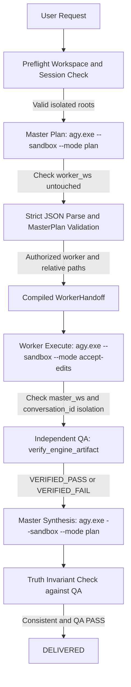

# Báo cáo kiểm toán PHASE 03 / P03.01: Spike tích hợp Master và Worker qua Antigravity CLI

## 1. Thông tin định danh và phạm vi kiểm toán

| Thuộc tính | Giá trị ghi nhận thực tế |
| :--- | :--- |
| Dự án | `AI-Village` tại `C:\DoCho\AI-Village` |
| Tiểu phase | `PHASE 03 / P03.01: Spike tích hợp Master -> Worker` |
| Nhánh Git | `main` |
| Commit nền đầu vào | `8dbff87126735ee0c0a94eb6dfcc39ea7330bb4f` |
| Engine thực thi chính | `antigravity` qua `antigravity_cli` tại `C:\Users\taine\.gemini\bin\agy.exe` phiên bản `1.5.15` |
| Trạng thái kiểm toán | `PASS` cho phạm vi `P03.01` |

Nhiệm vụ lần này kiểm chứng luồng cộng tác đa tác nhân thực thụ đầu tiên trên nền hợp đồng Engine trung lập đã hoàn thiện ở `PHASE 02`. Phạm vi triển khai giới hạn chặt trong `P03.01`, giữ nguyên trạng thái chưa quyết định `CrewAI` hay `Custom Orchestrator` cho `P03.02`, không sửa `agents/` và không đụng tới mã nguồn các phase sau.

## 2. Mục tiêu và ranh giới kiến trúc

Tiểu phase `P03.01` giải quyết câu hỏi thực nghiệm xem một tác nhân điều phối `core.master` và một nhân sự thực thi `it.artifact_worker` có thể phối hợp qua `EngineRegistry` với hai ngữ cảnh tách biệt và công cụ thao tác tệp thật hay không. Mọi trạng thái giả lập thành công từ mô hình đều bị xem là `UNVERIFIED` cho tới khi kiểm toán đĩa độc lập trả về `VERIFIED_PASS`.

Ranh giới tầng mã nguồn giữ đúng quy định trong `AGENTS.md`:

- Lớp `engines/` mở rộng trường `denied_paths` và `deny_shell_commands` trên `EngineRequest` để `AntigravityEngineAdapter` chuyển tiếp nguyên vẹn vào `AntigravityStreamRequest`.
- Lớp `core/orchestration/` điều phối quy trình hoạch định, kiểm tra chính sách bàn giao, gọi thực thi `Worker`, kích hoạt QA độc lập và kiểm tra tính trung thực của tổng hợp cuối.
- Thư mục `agents/` giữ trống tài liệu định nghĩa vai trò cho tới các phase sau; cặp vai trò spike `core.master` và `it.artifact_worker` định nghĩa nội bộ bằng Pydantic v2 trong `core/orchestration/spike_models.py`.

## 3. Sơ đồ chuỗi thực thi thực tế

Chuỗi thực thi vận hành qua ba lượt suy luận AI tách rời trên `agy.exe`. Giữa mỗi lượt đều có hàng rào xác thực bằng mã Python thuần trước khi chuyển quyền điều khiển sang bước tiếp theo.

## 4. Tóm tắt mô-đun và hợp đồng dữ liệu đã triển khai

| Tệp mã nguồn | Thành phần chính | Vai trò trong `P03.01` |
| :--- | :--- | :--- |
| `engines/contract.py` | `EngineRequest` | Bổ sung `denied_paths` và `deny_shell_commands` giữ nguyên `extra="forbid"` |
| `engines/providers/antigravity.py` | `AntigravityEngineAdapter` | Kích hoạt chế độ streaming và truyền `denied_read_write_paths`, `deny_shell_commands` vào `AntigravityStreamRequest` |
| `core/__init__.py` | Gói `core` | Khởi tạo package cho tầng điều phối |
| `core/orchestration/spike_models.py` | `parse_strict_json_object`, `SpikeAgentSpec`, `MasterPlan`, `WorkerHandoff`, `WorkerExecutionRecord`, `MasterSynthesis`, `AttributedSpikeEvent`, `MasterWorkerSpikeResult`, `OrchestrationError` | Ràng buộc schema JSON chặt, vai trò phân quyền `orchestrator` chỉ chạy `plan`, `worker` nhận bàn giao có rào chặn |
| `core/orchestration/spike_coordinator.py` | `validate_master_plan_policy`, `run_master_worker_spike` | Điều phối 4 giai đoạn fail-closed, kiểm tra ảnh chụp thư mục trước và sau mỗi lượt CLI |
| `core/orchestration/__init__.py` | Export công khai | Cung cấp giao diện nhập chuẩn cho kiểm thử và lớp gọi |

## 5. Bằng chứng chạy live End-to-End với Antigravity CLI

Lệnh kiểm thử live thực thi qua `$env:AI_VILLAGE_RUN_LIVE="1"; python -m pytest tests/integration/test_master_worker_spike_live.py -v -rs --log-cli-level=INFO` vào ngày `2026-11-24`. Bài test đạt `1 passed in 106.24s` với toàn bộ chuỗi ba tiến trình `agy.exe` thật bên trong `workspace\p03_01_spike_1ee65m2h`.

Dữ liệu thu được nguyên bản từ log `P03_01_LIVE_EVIDENCE`:

| Trường bằng chứng | Giá trị đo thực tế |
| :--- | :--- |
| `correlation_id` | `corr-59b284583d7f` |
| `status` | `DELIVERED` |
| `master_session_id` | `sess-master-f1298fa3fc` |
| `worker_session_id` | `sess-worker-f7b82c4558` |
| `master_plan_conversation_id` | `ff24c4f4-537c-4495-9e25-11fc74cf000b` |
| `worker_conversation_id` | `7d469871-272a-49da-88ac-a2dbb6609946` |
| `master_synthesis_conversation_id` | `1030d732-fb38-4b90-9617-53ba6f50a24a` |
| `worker_observed_tools` | `["read_file", "write_file"]` |
| `qa_status` | `VERIFIED_PASS` |
| `qa_expected_sha256` | `c50b77fd0ab5f284d208122b3c98620d85382870405238f92e8e6efb1d871d0f` |
| `qa_actual_sha256` | `c50b77fd0ab5f284d208122b3c98620d85382870405238f92e8e6efb1d871d0f` |
| `qa_source_integrity_verified` | `true` |
| `attributed_event_count` | `211` |
| `total_duration_ms` | `105618` |

Giá trị `verification_marker` bí mật chỉ nằm trong `worker_ws\package.json`, hoàn toàn vắng mặt trong `user_request` và `master_ws`. Điều đó chứng minh `Worker` thực sự đọc tệp qua công cụ `read_file` và tạo `proof.txt` qua công cụ `write_file` rồi khớp chính xác hàm băm `SHA-256`.

## 6. Kiểm chứng cách ly phiên và ranh giới thư mục

Cả hai phía `Master` và `Worker` được cách ly trên cả ba lớp cấu trúc: phiên logic, hội thoại nhà cung cấp và ranh giới tệp hệ điều hành.

1. Ba ID hội thoại CLI `ff24c4f4-537c-4495-9e25-11fc74cf000b`, `7d469871-272a-49da-88ac-a2dbb6609946` và `1030d732-fb38-4b90-9617-53ba6f50a24a` hoàn toàn phân biệt với cặp ID phiên logic `sess-master-f1298fa3fc` và `sess-worker-f7b82c4558`.
2. Lượt `master_plan` mang mã `req-79c919498b53` và `master_synthesize` mang mã `req-5da1bd7eb546` chạy trong `master_ws` với cờ `--sandbox --mode plan --output-format stream-json --print-timeout=120s --settings <redacted_rules>`, nhận `denied_paths=[worker_ws]` và `deny_shell_commands=True`.
3. Lượt `worker_execute` mang mã `req-82818e58a6d0` chạy trong `worker_ws` với cờ `--sandbox --mode accept-edits --output-format stream-json --print-timeout=120s --settings <redacted_rules>`, nhận `denied_paths=[master_ws]` và `deny_shell_commands=True`.
4. Coordinator chụp toàn bộ hàm băm cây thư mục `worker_ws` trước và sau `master_plan`, đồng thời chụp cây thư mục `master_ws` trước và sau `worker_execute`. Tổng cộng `211` `AttributedSpikeEvent` được gắn nhãn giai đoạn, tác nhân và phiên logic chuẩn xác.

## 7. Kiểm chứng QA độc lập tách rời kết quả mô hình

Hợp đồng kết quả của `Worker` giữ `EngineResult.status == "SUCCEEDED"` nhưng luôn cố định `business_verification_status == "UNVERIFIED"`. Ngay sau khi lượt `Worker` kết thúc, `spike_coordinator.py` gọi `verify_engine_artifact` để đọc trực tiếp từ đĩa, đối chiếu hàm băm nguồn `package.json` và xác minh từng byte của `proof.txt`.

Tại lượt live thật, `verify_engine_artifact` xác nhận `proof.txt` khớp `c50b77fd0ab5f284d208122b3c98620d85382870405238f92e8e6efb1d871d0f` và `qa_source_integrity_verified == true`. Bước `MasterSynthesis` tiếp theo chỉ được đánh dấu `DELIVERED` sau khi `_validate_synthesis_truth` kiểm tra chữ ký `qa_status_observed`, `artifact_relpath` và `artifact_sha256` khớp đúng kết quả từ `verify_engine_artifact`.

## 8. Ma trận kiểm thử Fail-Closed và trạng thái kiểm chứng

| Kịch bản kiểm thử | Mô tả tình huống lỗi hoặc biên | Trạng thái | Nguồn kiểm chứng |
| :--- | :--- | :--- | :--- |
| Kịch bản 01 | `Master` trả văn bản tự do, mảng hoặc JSON lỗi cú pháp | `UNIT_VERIFIED` | `test_parse_strict_json_object_rejects_prose_and_broken_json`, `test_scenario_01_master_garbage_text_fails_closed` |
| Kịch bản 02 | `Master` chỉ định `target_worker_id` lạ, không được phép hoặc tự trỏ `core.master` | `UNIT_VERIFIED` | `test_scenario_02_unauthorized_target_worker_blocked` |
| Kịch bản 03 | `Master` chèn path traversal, đường dẫn tuyệt đối hoặc ký tự đại diện `*` | `UNIT_VERIFIED` | `test_scenario_03_path_traversal_and_wildcards_rejected` |
| Kịch bản 04 | `Master` đòi đọc tệp ngoài phạm vi hoặc cấp quyền ghi đè lên `package.json` | `UNIT_VERIFIED` | `test_scenario_04_disallowed_file_and_protected_overwrite_blocked` |
| Kịch bản 05 | `WorkerObjective` chứa chuỗi nhạy cảm, worker cho phép shell hoặc `WorkerHandoff` bật shell | `UNIT_VERIFIED` | `test_scenario_05_sensitive_context_and_shell_bypass_rejected` |
| Kịch bản 06 | Tiến trình `Master` tự ý ghi vào `worker_ws` dù chạy ở chế độ `plan` | `UNIT_VERIFIED` | `test_scenario_06_master_mutating_worker_workspace_blocked` |
| Kịch bản 07 | Chuỗi đầy đủ `User -> Master Plan -> Handoff -> Worker -> QA -> Master Synthesis` | `LIVE_VERIFIED` | `test_live_master_worker_integration_spike` và `test_scenarios_07_08_11_15_full_flow_qa_separation_and_isolation` |
| Kịch bản 08 | `Worker` `UNVERIFIED` trước QA và tách biệt rạch ròi với `VERIFIED_PASS` | `LIVE_VERIFIED` | `test_live_master_worker_integration_spike` và `test_scenarios_07_08_11_15_full_flow_qa_separation_and_isolation` |
| Kịch bản 09 | `Worker` gặp `FAILED`, `TIMED_OUT` hoặc `CANCELLED` | `UNIT_VERIFIED` | `test_scenario_09_worker_failure_timeout_cancel_prevents_delivery` |
| Kịch bản 10 | `Worker` báo thành công giả trong khi thiếu tệp, sai SHA-256 hoặc làm hỏng `package.json`, và `Master` tìm cách sửa kết quả QA | `UNIT_VERIFIED` | `test_scenario_10_qa_catches_bad_artifact_and_blocks_master_override` |
| Kịch bản 11 | Phân tách ID phiên, ID hội thoại, gắn nhãn `211` sự kiện và chặn va chạm ID hoặc `Worker` ghi sang `master_ws` | `LIVE_VERIFIED` / `UNIT_VERIFIED` | Live test + `test_scenario_11b_conversation_collision_and_master_dir_tamper_blocked` |
| Kịch bản 12 | Chặn mặc định thư mục OS temp, thư mục lồng nhau, ngoài `allowed_root` hoặc trùng ID phiên | `UNIT_VERIFIED` | `test_scenario_12_workspace_isolation_violations_blocked_preflight` |
| Kịch bản 13 | Tổng hợp cuối sai JSON schema hoặc sai `artifact_sha256` | `UNIT_VERIFIED` | `test_scenarios_13_14_16_synthesis_errors_honest_telemetry_and_partial_state` |
| Kịch bản 14 | Telemetry giữ giá trị thực đo hoặc `null` trung thực khi thiếu từ provider | `LIVE_VERIFIED` / `UNIT_VERIFIED` | Live test + `test_scenarios_13_14_16_synthesis_errors_honest_telemetry_and_partial_state` |
| Kịch bản 15 | Hai vai trò gọi độc lập qua `EngineRegistry` với cấu hình `denied_paths` và `deny_shell_commands` truyền tới `AntigravityStreamRequest` | `LIVE_VERIFIED` / `UNIT_VERIFIED` | Live test + `test_scenario_15b_antigravity_adapter_forwards_sandbox_settings` |
| Kịch bản 16 | Lưu đầy đủ bản ghi trung gian và danh sách sự kiện khi quy trình đứt gãy ở bước sau | `UNIT_VERIFIED` | `test_scenarios_13_14_16_synthesis_errors_honest_telemetry_and_partial_state` |

Toàn bộ các nhánh kích hoạt lỗi cố ý đối với `agy.exe` thật như ngắt đột ngột hoặc giả mạo tệp giữa tiến trình CLI không chạy lại trong bài live lần này mà được kiểm chứng qua kiểm thử đơn vị có điều khiển; các nhánh đó được ghi nhận là `UNIT_VERIFIED`.

## 9. Phân tích Telemetry trung thực

| Giai đoạn | Thời lượng đo được | Thời gian provider báo | Input tokens | Output tokens | Thinking tokens | Cached tokens | Tổng tokens | Chi phí USD |
| :--- | :--- | :--- | :--- | :--- | :--- | :--- | :--- | :--- |
| `master_plan` | `32714 ms` | `23.0191638 s` | `23612` | `1628` | `1226` | `0` | `25240` | `null` |
| `worker_execute` | `43022 ms` | `34.3638177 s` | `30118` | `1386` | `925` | `64089` | `31504` | `null` |
| `master_synthesize` | `26244 ms` | `18.4371841 s` | `24076` | `1391` | `961` | `0` | `25467` | `null` |

Cả ba lượt đều mang nhãn `telemetry_status = "VERIFIED_MEASURED"` và `telemetry_source = "provider_cli"`. Hai trường `estimated_cost_usd` và `actual_cost_usd` giữ `null` vì `agy.exe` không phát hành dữ liệu đơn giá. Trường hợp provider không cung cấp token cũng được kiểm tra riêng trong `test_scenarios_13_14_16` để bảo đảm giữ nguyên `None` với trạng thái `UNAVAILABLE_FROM_PROVIDER`.

## 10. Quan sát thực nghiệm về độ trễ, ma sát và giới hạn

1. Tổng thời gian thực thi live cho một tác vụ nhỏ ba lượt suy luận lên tới `105618 ms` với hơn `82211` tổng token tính theo từng lượt cộng gộp chưa tính cache `64089` ở lượt Worker. Nguyên nhân chính đến từ việc mỗi lệnh `agy.exe` khởi chạy phiên nền tảng kèm ngữ cảnh hệ thống khoảng `23000` đến `30000` input tokens.
2. Trên Windows, các tiến trình MCP con do `agy.exe` gọi có thể giữ khóa thư mục tạm trong vài trăm mili-giây sau khi thoát, đòi hỏi `test_master_worker_spike_live.py` chạy dưới `workspace/` với vòng lặp thử lại xóa tối đa `10` lần cách nhau `0.3s`.
3. `agy.exe` v`1.5.15` chưa hỗ trợ `structured_output` cấp API trên `EngineCapabilities`, nên điều phối phải phụ thuộc hoàn toàn vào prompt nghiêm ngặt kết hợp `parse_strict_json_object` và hậu kiểm schema Pydantic fail-closed.
4. Spike hiện thời thực thi tuần tự 1 `Master` với 1 `Worker` và chưa tích hợp SQLite Journal hay máy trạng thái đa phiên lưu bền vững của `PHASE 04`.

## 11. Khuyến nghị cho bước quyết định ở `P03.02`

Kết quả `P03.01` cung cấp số liệu đo thực chất để `P03.02` so sánh `CrewAI` với `Custom State Machine Coordinator`. Nhóm đánh giá ở `P03.02` cần đo xem liệu việc bọc thêm vòng lặp tác nhân của `CrewAI` trên đỉnh `agy.exe` có làm nhân bội độ trễ `~26s-43s` mỗi lượt và tiêu hao `~24k` input tokens mỗi bước hay không, so sánh trực tiếp với mô hình điều phối Python gọn nhẹ kế thừa thẳng từ `core/orchestration/`. Tài liệu kiểm toán này không tự chốt framework nào trước khi bài đánh giá có kiểm chứng ở `P03.02` hoàn tất.

## 12. Tuân thủ Chặng A và ranh giới thư mục

- Thư mục `agents/` giữ nguyên hai tệp `[".gitkeep", "README.md"]`, không có bất kỳ tệp `.yaml` hay mã nguồn nào.
- Thư mục `workspace/` trở về trạng thái sạch chỉ còn `[".gitkeep"]` ngay sau khi kiểm thử live kết thúc.
- `tests/stage_a/test_stage_a_baseline.py` chỉ nới đúng quyền cho `core/__init__.py` và `core/orchestration/*.py`, tiếp tục chặn mọi tệp `.py` và `.js` trong `agents`, `tools`, `skills`, `storage`, `api`, `sandbox` cũng như các thư mục con khác ngoài `core/orchestration/`.
- Không có phụ thuộc mới nào được cài vào `pyproject.toml`.

## 13. Kết quả bộ kiểm thử hồi quy và live

| Lệnh kiểm thử | Kết quả | Thời gian | Ghi chú phạm vi |
| :--- | :--- | :--- | :--- |
| `python -m pytest tests -v` | `76 passed, 21 skipped` | `4.06s` | Chạy sau khi hoàn tất mã nguồn và kiểm thử đơn vị; `21` bài `@pytest.mark.live` bỏ qua khi chưa bật `AI_VILLAGE_RUN_LIVE=1` |
| `$env:AI_VILLAGE_RUN_LIVE="1"; python -m pytest tests/integration/test_master_worker_spike_live.py -v -rs --log-cli-level=INFO` | `1 passed` | `106.24s` | Chạy end-to-end thật qua `agy.exe` ba lượt với đầy đủ QA SHA-256 |

## 14. Đối chiếu tiêu chí nghiệm thu `P03.01`

| Tiêu chí | Đạt yêu cầu | Bằng chứng đối chiếu |
| :--- | :--- | :--- |
| Hai vai trò `Master` và `Worker` suy luận AI thật qua `EngineRegistry` | Đạt | Ba lượt `agy.exe` riêng biệt ghi nhận trong `P03_01_LIVE_EVIDENCE` |
| `Worker` thao tác công cụ tệp thật tạo artifact và bảo toàn tệp nguồn | Đạt | `observed_tool_names: ["read_file", "write_file"]`, `qa_source_integrity_verified: true` |
| Kiểm toán đĩa QA độc lập và tách `UNVERIFIED` khỏi `VERIFIED_PASS` | Đạt | `verify_engine_artifact` khớp SHA-256 `c50b77fd...d0f` |
| Cách ly phiên, thư mục, `--sandbox`, `--settings` và gán nhãn sự kiện | Đạt | Cờ `--sandbox` cùng `denied_paths`, `deny_shell_commands=True` và `211` sự kiện gắn nhãn |
| Không cài thêm framework hay vượt phạm vi sang `P03.02` hoặc `PHASE 04+` | Đạt | Giữ nguyên dependencies và ranh giới thư mục theo `test_stage_a_baseline.py` |

## 15. Chuyển tiếp bước tiếp theo

Tiểu phase `P03.01` hoàn thành đầy đủ tiêu chí nghiệm thu kỹ thuật và an toàn. Công việc kế tiếp hợp lệ theo lộ trình là `P03.02` nhằm đánh giá khách quan giữa `CrewAI` và kiến trúc điều phối tùy biến dựa trên dữ liệu đo đạc từ spike này.
